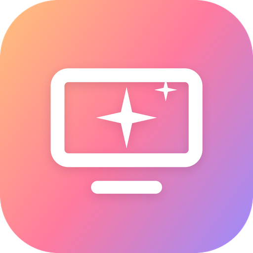
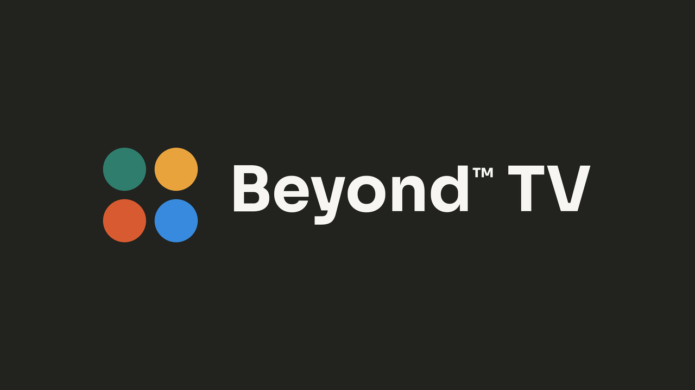
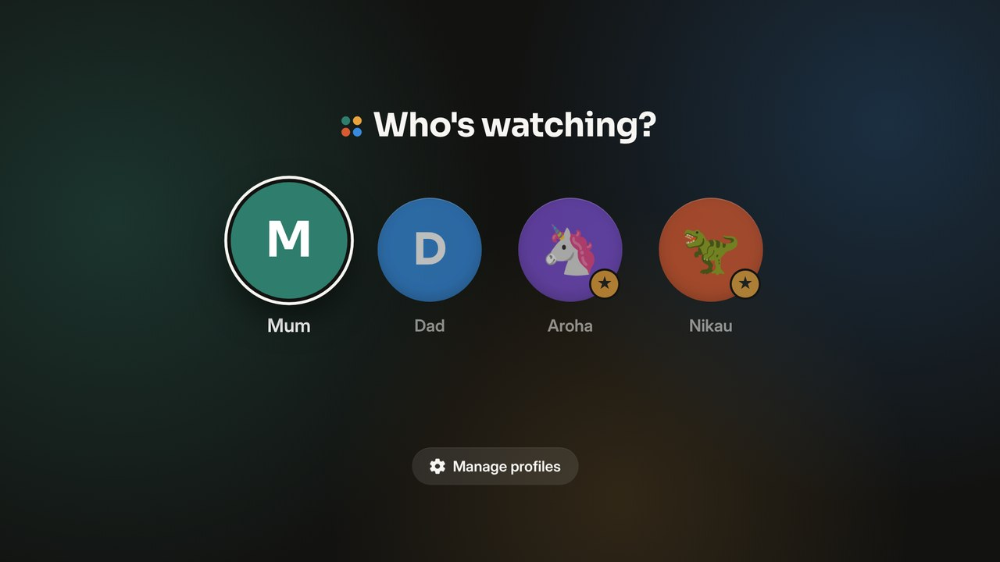
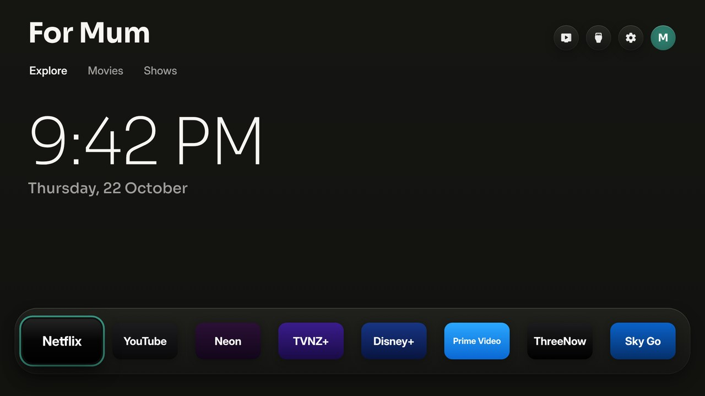
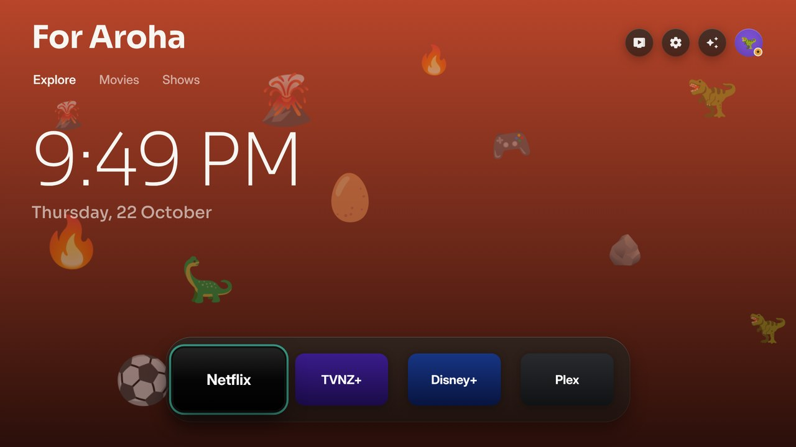
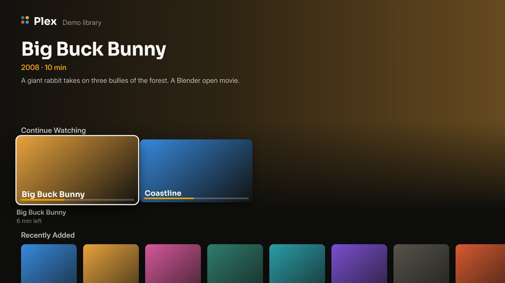
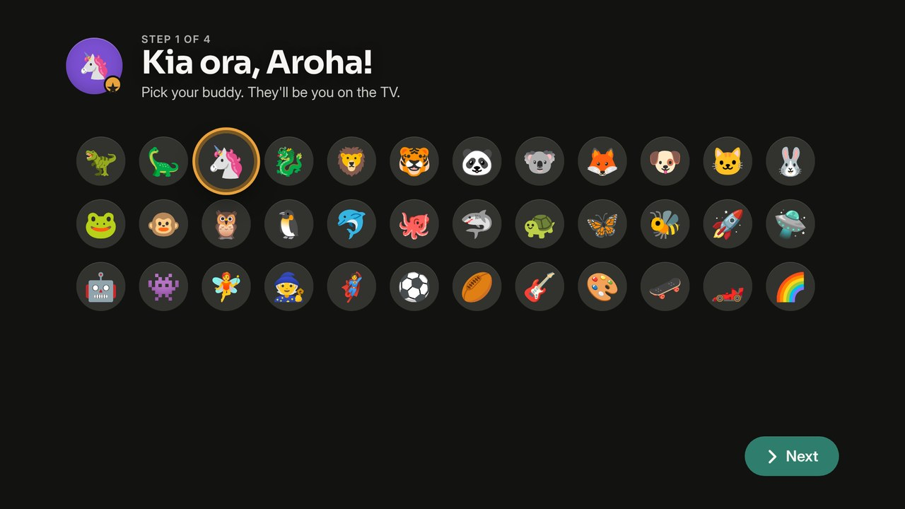
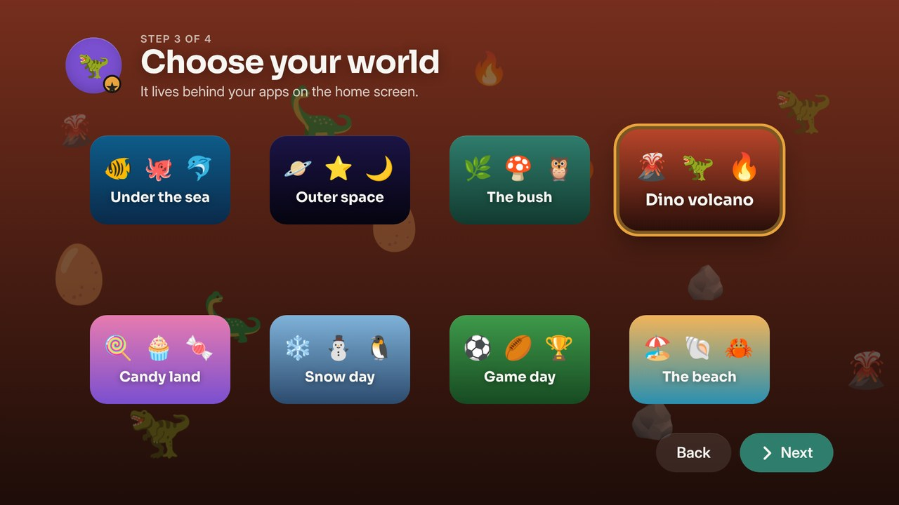
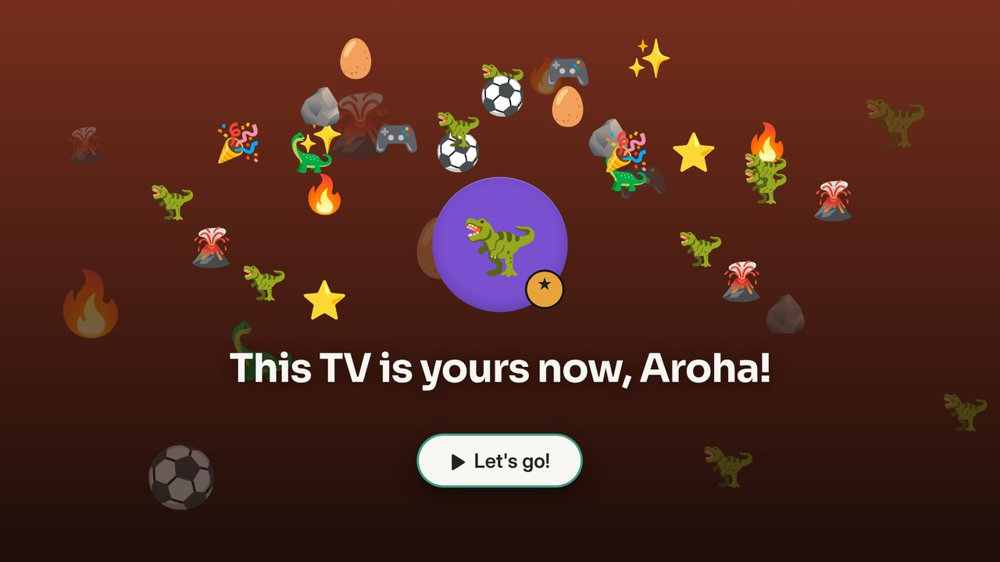
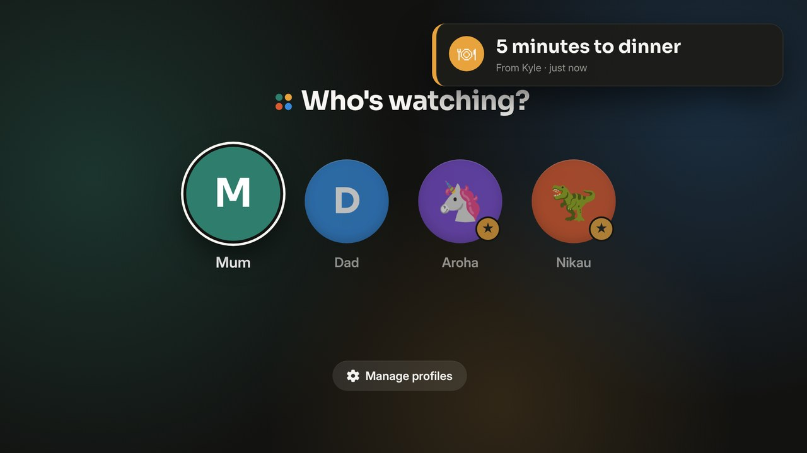

<div align="center">



# Beyond™ TV

## Free your world.

**One calm home screen for the whole whānau, on Google TV, LG and Samsung TVs.**

Your streaming apps in one App Dock, what's worth watching tonight, and no ads.<br>
Free and open source, built in Aotearoa by [Beyond](https://gobeyond.co.nz). One button to undo.

[Install](#install) · [LG TVs](#lg-tvs-webos) · [Samsung TVs](#samsung-tvs-tizen) · [Any TV](#any-tv) · [Change the code](#change-the-code) · [Roadmap](#roadmap)



</div>

## Screenshots

<table>
<tr><td></td>
<td></td></tr>
<tr><td></td>
<td></td></tr>
<tr><td></td>
<td></td></tr>
<tr><td></td>
<td></td></tr>
</table>

## What you get

- **Who's watching.** Family first, then the grown-ups (Mum leading) and the kids, with kind notes floating up for each of them. Kids get only their own apps and family-friendly picks, behind a grown-up PIN; teens get YouTube and music too. Grown-ups can have their own PIN, or allow it from their phone.
- **Your apps, front and centre.** Netflix, Neon, TVNZ+, Disney+, ThreeNow, Plex and the rest in one App Dock, in the order you pick on the TV.
- **No ads.** No sponsored rows, banners or autoplaying promos.
- **A home screen of its own.** "Kia ora" with your name, Keep watching, and Tonight at home beside it: tea, birthdays, today's calendar, notes and the weather. It opens on *Continue*: the app, Live TV channel or game you had on last, one OK press away.
- **Beyond™ TV Channels.** Live TV is one numbered line-up you surf like a real TV: up and down to change channel, numbers to jump, OK for the guide. NZ News, NZ Music, NZ Shows and NZ Sport sit beside the world news channels, and *Choose channels* turns off the ones you don't watch.
- **Live TV, now and next.** Every free channel shows what's on now, and the one you're on says what's up next and when. Hold OK on a channel to pin it to *Your favourites*, the first row, for whoever is watching.
- **Trending, not sponsored.** Fresh picks every hour from what's trending and the latest releases, only from apps you already have.
- **Games on the TV.** Press Games for karaoke, quiz night, a party, board and card games, Remote Control Land, Lolly Land, Build it, the arcade, silly games, the light show, the tidy-up race, Daily chores and the family scoreboard, each with its own picture, in four groups: Let's play, Build it, Party time and Round the house. All of it starts from the remote, and Back from a game goes back to Games; phones are an extra, never a must.
- **Karaoke night.** Pick who's singing and a song, and the TV plays its karaoke version with the words on screen, then moves on to the next singer by itself. Save playlists for next time, or press **Take turns**: everyone adds a song and the TV makes sure nobody sings twice until everyone's had a go.
- **Screen time, kindly.** Give each kid a daily limit on the TV (30 minutes to 3 hours). The home screen shows what's left, a gentle note comes five minutes before the end, and then a calm "That's screen time for today" screen in their own colour. A grown-up's PIN adds 15 minutes, or, with Beyond Family, *Ask a grown-up*: the kid asks for 15 or 30 more minutes or one more game, and Mum or Dad says yes or not now with one tap on their phone.
- **Board and card games.** Ludo, Chess, Snap and our own slap games, against robots named after our birds that get a little smarter each time you beat them. The dice are fair and the robots never cheat.
- **Learn chess.** Fifteen short lessons on the board, one idea each: every piece, check, checkmate, castling, en passant, promotion and stalemate, each one tried with the remote. Then a game with a coach that says after every move how good it was, why, and what would have been better, gives a hint when you're stuck and a second chance before a big mistake.
- **How to play, for every game.** Games › How to play has a short guide to each game: the aim, the buttons, the rules and tips, in words kids can follow. It's in each game too, and one press of Back away mid-game.
- **Remote Control Land.** Pick a race car, a monster truck, a digger, a dune buggy or a bulldozer and drive it round a park full of ramps, turbo pads, a pond and a sandpit. Front flips, back flips and spins in the air, crates and sandcastles to smash, stars and balloons to catch, combos and challenges. Or take to the lake on a jet ski, a speedboat, a surfboard or water skis: ski ramps, waves to surf, islands, rubber ducks and hoops. Healthy snacks to drive through for points, and sugary ones to dodge. Three cameras: from above, chase and first person (Back, then ◀ ▶). Race mode: two laps through the gates against the clock, where every 500 stunt points takes a second off, on your own or two players taking turns. All on the arrows and OK.
- **Lolly Land.** A candy world for little ones: lolly trees, a chocolate river, a rainbow bridge and seven places to play. Bake a cake and pile on the toppings, grow lollies in the garden, serve friends in the sweet shop, catch a lolly shower, fly a unicorn along the rainbow, dress up at the castle, and spend the stars from Daily chores at the Star Stall. Nothing is ever lost and there is no game over: every go ends in a celebration, the TV cheers and says lovely things (out loud where it can), and sparkles bring new friends, from a unicorn to a baby dragon. It stays on the TV. Games › Let's play.
- **The Morning board.** Press *Today* on the home screen (or it comes up by itself the first time each morning): everyone's to-dos from Beyond Family in a column each, ticked off with the remote, today's calendar and the weather. *Show it each morning* turns the morning part off.
- **Daily chores.** Each kid's jobs for the day on the TV, with a picture for each: make my bed, get dressed, brush my teeth, tidy my room and more (a grown-up picks them). Press OK when one's done for a star; do all of today's for the daily challenge and two more. The tidy-up race ticks *Tidy my room* by itself. Stars are spent at the Star Stall in Lolly Land on a sparkle shower, magic rain for the garden, a star crown and star wings. Games › Round the house.
- **Tidy-up alarm.** Set the time and the days in Beyond Family, like 7:15 on school nights, and the TV turns itself on and starts the tidy-up race. If nobody presses a button within 5 minutes, it turns itself back off, so a weekend away doesn't leave it on all night. *We're away* pauses it until you're home.
- **The family scoreboard.** Points from every game and every chore, a week at a time, Monday to Sunday. Win a game for 3, finish one for 1 or 2, a point a chore. When the week ends everyone gets their own award for what they did best (Arcade ace, Chore champion, Master builder) and the most points is the champion of the week, so every kid wins something. On the Family profile a game for one asks *Who's playing?* first. It stays on the TV. Games › Round the house.
- **Build it.** Build a road the way it's done for real, one job after another: survey and peg out, clear the land, dig it level, put in the drains, spread the gravel, roll it hard, lay the asphalt, paint the lines and open it. First pick the right machine for each job (a wrong one says what it's really for), then drive it with the arrows and OK. The front of the road is cut away so the layers show. Build a bridge: six crossings from a farm creek to the harbour, where you pick the shape (beam, legs, arch, truss or suspension) and the material (wood, concrete or steel) within the money, then a test truck drives over; if it falls, it says why. Plan a town: a village, a country town and a busy town, where you lay the roads and give people what they need (water, power, food, a school, a doctor, jobs, a fire station), and every house shows a happy or sad face and says what's missing.
- **Arcade and silly games.** Eel, Paddle, Sky Guard and Dot Chase, played with the arrows and OK. Then Who's most likely to, Would you rather and Spin for a dare for everyone in the room.
- **Launch Crew.** Beyond™'s own rocket game, from gobeyond.nz, now on the big screen: board the crew, fuel up, help the engineers fix the sparks and fly to the Moon, zapping the scam messages and letting the real ones from Mum and Nana through. Kids learn what a scam looks like, and getting one wrong takes nothing away. Games › Arcade.
- **School lunches.** Kids swipe through lunch ideas with the remote and fill Monday to Friday. You get the list of what they chose, a Sunday cook-up to make it ahead, and the shopping list. All nut free, and it stays on the TV. Games › School lunches.
- **Make it yours.** Kids make it theirs on their own profile, with the remote, no grown-up needed: a buddy, a colour, a world that fills their home screen, and the things they love drifting through it.
- **Tonight's sky.** Press the star for a star chart of the sky over your house, with the Southern Cross, Matariki and the moon's phase, moonrise and next full moon. Worked out on the TV, no internet. Press down for **Look around**: the sky as a window you turn with the arrows, naming whatever is in the middle.
- **Art on the wall.** When nobody's watching, paintings fill the screen like a picture frame, a new set each day, with our own art at Halloween and Christmas.
- **Family photos on the screensaver.** Scan the code on the TV with your phone and send your own photos and the kids' art. Photos drift slowly across the screen, and every few photos a drawing hangs on the wall in a white frame with the artist's name under it. They stay on the TV. (Google TV for now.)
- **Beyond Family on the big screen.** Linked to [Beyond Family](https://beyondfamily.app): messages and notes from your phone, the dinner question, *Have the pets been fed?*, a phone remote, and turning the TV on and off from your phone.
- **Pinned tiles.** Pick up to six tiles in Beyond Family: an app, a show, the kids' jobs ticking off, a camera at home. Every TV opens on them.
- **Your home and your music.** With Beyond Home, a card for each room, Movie night in one press and one remote for the sound and the lights. With Beyond Music, your own albums and New Zealand radio on the remote.
- **Te reo word of the day.** A new kupu on the home screen each day, with what it means.
- **Find, by voice.** Press the microphone at the top and say a game, a channel, an app or a show ("Candy Land", "Sky News", "Bluey"), and it comes up to open with OK. No voice on your TV? Type it with the remote instead.
- **Bedtime made easy.** A sleep timer under the App Dock, and Bedtime: pick rain, waves or a fan and how long, then a night light breathes with the kids as the screen and the sound fade, and the TV turns itself off.
- **Weather one press away.** Hour by hour, with sunrise and sunset.
- **Light by day, dark by night.** It follows your city's real sunset.
- **Keeps itself up to date.** New versions arrive by themselves, and one OK puts them on.
- **Beyond's look.** The four dots, Beyond's purple and Sora headings, the same family as [Beyond Family](https://beyondfamily.app).
- **Safe.** No root. Nothing is uninstalled. One button brings back the factory home screen.

## Roadmap

1. Who's watching: done. Family first (everyone together, family-friendly picks), then a profile for each person, with kids' profiles behind a grown-up PIN, and no settings at all for kids. Asked every time the TV comes on.
2. Plex built in: link with a code at plex.tv/link, then Continue Watching and Recently Added on the home screen.
3. All your services as one: one "What's on" across every service you have, opening each title in its own app.
4. Beyond Family: pairing the TV with your household (a code typed into the app), the household's people as profiles, a phone remote and messages on the screen (full screen, even over YouTube on Google TV, until somebody presses OK): done on Google TV, LG and Samsung. On Google TV in Beyond TV mode the remote works inside other apps too. Voice search for kids is done (Find, below). Still to come: the family house game on the big screen.
5. Picks for kids: done on Google TV, LG and Samsung. A kid's cards are good shows matched to what they're into, set by a grown-up (Beyond Family or behind the PIN) or by the kid ("What do you like to watch?"), and coming back from an app the TV now and then suggests one. No TMDB key needed. On Google TV the picks come from what is set in Beyond Family; the "What do you like to watch?" card and the suggestion after an app are LG and Samsung for now.
6. Two homes, one show: done on LG and Samsung. The Beyond Family app starts a countdown on every TV in two linked homes, and reactions come from phones. Google TV once it pairs with Beyond Family.
7. Earn your screen: done on Google TV, LG and Samsung. Switched on in Beyond Family, a kid's apps wait until their jobs for today are ticked off. On Google TV the remote's own app buttons (Netflix, YouTube) still open their apps for now.
8. The house noticeboard: done on LG, Samsung and Google TV. Switched on in Beyond Family, today's calendar, tea, birthdays and notes show in Tonight at home, and on LG and Samsung beside the screensaver clock too.
9. Bedtime: done on Google TV, LG and Samsung. Pick a calm sound (rain, waves, a fan or quiet) and 15, 30 or 45 minutes, then a night light breathes, slowing from six breaths a minute; the light and the sound fade, and the TV turns itself off (on Samsung the screen goes dark instead). From the moon on the home screen in the evening, Games, Find or the Beyond Family app.
10. Fine day nudge: done on LG and Samsung. On a mild, dry day the TV suggests going outside, and counts the time as green time in Beyond Family when you're back.
11. Dinner question: done on Google TV, LG and Samsung. One question on the TV from Beyond Family, answered from phones, and the answers revealed together.
12. Te reo word of the day: done on Google TV, LG and Samsung. A new kupu each day on the home screen, with what it means, and on the LG and Samsung screensaver how to say it. Te reo is a choice under *Language* in Beyond™ TV Settings: *English and te reo Māori*, or plain *English*, where the word of the day goes and "Kia ora" becomes "Hello".
13. Beyond™ TV for business (testing now): shop-window screens changed from the web, as a subscription. Open tv.beyondspaces.nz on the TV, type its code into Beyond™ Spaces, and it plays your pictures, videos and web pages. Free for homes, always.
14. Your face on any TV: done on Google TV, LG and Samsung. Each person's face, colour, world, loves and shelf live with them in Beyond Family, so every TV at home shows them and a new TV brings them across. On somebody else's Beyond TV, Who's watching › Sign in with Beyond Family shows a code to type into your phone, and your own profile is there until you sign out. Google TV takes the face, colour, world and loves; the shelf follows.
15. Sleep timer: done on Google TV, LG and Samsung. Sleep Timer in the menu under the App Dock: each press picks 15, 30, 60 or 90 minutes, or off. A note a minute before, then the TV turns off (on Samsung, which lets no app turn it off, the screen goes dark until a key is pressed).
16. Art mode: done on Google TV, LG and Samsung. Like a Samsung Frame, the screensaver shows paintings from the Art Institute of Chicago's public domain collection, filling the screen with no clock or words on it (family messages still show; only paintings about the screen's shape are picked, so little is cropped), a new set each day. Beyond™ TV Settings › Kind of art picks landscapes, the sea, gardens and flowers, mountains, impressionism, still life or Mixed (a different theme each day). On Mixed, in a season it shows our own art instead: Halloween (24/10 to 1/11) and a New Zealand summer Christmas (1/12 to 26/12), drawn by `tools/season_art.js` and listed in `docs/art/seasons.json`, so new pictures reach every TV without an update. On by itself when there is no TMDB key; Beyond™ TV Settings › Screensaver picks Art or Film photos.
17. Have the pets been fed?: done on Google TV, LG and Samsung. When a kid picks their face and the household's pets in Beyond Family still want a meal, the TV asks. "Yes" ticks them fed in Beyond Family with the kid's name; "Not yet" sends them off and the TV asks again later.
18. A home screen of its own: done on LG, Samsung and Google TV. A "Kia ora" greeting with your name, Keep watching (what you last opened from Beyond, per profile, as little TV screens; Netflix doesn't share its own list, so it's what Beyond opened), and Tonight at home beside it: tea, birthdays, today's calendar, notes and the weather, with a Beyond Family badge and faces when linked.
19. Your home: done on Google TV, LG and Samsung (Google TV shows the first three rooms). With a Beyond Home box (the Beyond Home app on a Home Assistant box) on the same network, the home screen gets a *Your home* tab: a card for each room, Moments like Movie night in one press, one remote for the room's sound and every light, heat pump, blind and plug on or off. Pair once with a code typed in the Beyond Home app (Settings, TVs). The TV only asks for named things; the box decides what that means and refuses anything off its list. On the way: energy (what the house is using now, how much the solar covers, the cheapest time to run the dishwasher), cameras with a password and live video, and your house as you drew it in Beyond Family.
20. Pinned tiles: done on Google TV, LG and Samsung. Pick up to six tiles in Beyond Family and every TV at home opens on them: an app, a show you're all watching, the kids' jobs for today ticking off, or a camera on your home network (its picture every few seconds, full screen on OK). The camera's picture comes straight to the TV, never through Beyond Family. Google TV shows the first three; cameras with a password, and live video, come with Beyond Home.
21. Tidy-up race: done on Google TV, LG and Samsung. Set a time in Beyond Family (TV › Tidy-up alarm), and on the days you pick the TV asks Who's tidying? (everyone ticked; OK on a face takes them out, then Go), starts a clock counting up from 0:00 with those faces; whoever's done presses OK on theirs and gets their place and time, then "All tidy!". Nobody runs out of time. Google TV turns itself on for it (through its own ADB, with the key it already allowed); LG and Samsung start it when the TV is on. From the remote in Beyond Family any time.
22. The start chime: done on Google TV, LG and Samsung. Four soft notes, one for each of Beyond's dots, when the TV comes on and when the tidy-up race starts and ends. Beyond™ TV Settings › Sounds turns it off. The notes are in ADR 0012; `tools/make_chime.py` writes them as a WAV.
23. Quiz night: done on Google TV, LG and Samsung. Ten family-friendly questions on the TV, four answers each; everyone buzzes in from their phone in Beyond Family, the first tap counts, right is two points and first right in gets one more. The answer and the scores come up when a grown-up says so, then the final scores. Still to come for the family evening: arcade games played with the remote.
24. Party mode: done on Google TV, LG and Samsung. A disco or a birthday, from the Party button on the TV (no phone needed) or from Beyond Family: music the TV makes itself, coloured lights sweeping the screen on the beat, and for a birthday the tune, a cake and their name. With Beyond Home, the room's lights go bright and colourful, change with the music, and go back to warm white after.
25. Teen profiles: done on Google TV, LG and Samsung. A kid of 13 or more gets YouTube and music on their shelf as well as the kids' apps, still behind the grown-up PIN. Beyond Family works it out from their birthday, so it happens by itself on the day; the TV only hears yes or no.
26. Karaoke night: done on Google TV, LG and Samsung. Keep the songs your family loves in Beyond Family, queue up from your phones, and Next singer puts whoever's up on the TV, then plays the song's karaoke version from YouTube, words and all.
27. Games on the TV: done on Google TV, LG and Samsung. A Games button on the home screen holds karaoke, a party, quiz night, the dinner question, the tidy-up race and Bedtime, all started from the remote. Pick who's singing and a song right on the TV, and run the quiz from the couch: show the answer, next question, finish. Who's watching fits a big family on one screen.
28. Karaoke playlists: done on Google TV, LG and Samsung. Every song plays inside Beyond TV's own player and the night goes from one singer to the next by itself. Build and save playlists (songs and who sings each) with the remote or on your phone, and songs find their best karaoke version, Sing King and Lost Panda first.
29. Tonight's sky: done on Google TV, LG and Samsung. The star button on the home screen opens a star chart of the sky over the house (the Southern Cross, Matariki, the brightest stars and the constellations) beside the moon: its phase as it looks from here, moonrise and moonset, and the next full and new moon. Left and right move it an hour. Worked out on the TV, no internet. Planets next. ADR 0023.
36. Look around: done on Google TV, LG and Samsung (press down on Tonight's sky). The sky as a window: the arrows turn the view round the compass and tilt it, with the horizon, the four directions, the stars, the constellation lines, the moon and the sun drawn where they really are from here. Whatever is in the middle of the screen is named, with where it is and a line about it (the Southern Cross, Matariki, the brightest stars, the moon's phase). OK finds the Moon, the Southern Cross, Matariki or the brightest star up, or moves the time. A phone's compass can point the view too (item 40). Next: star signs from the birthdays in Beyond Family. ADR 0036.

30. Board and card games: done on Google TV, LG and Samsung (Games › Board and card games). Pick who's playing, then Ludo, Chess, Sheep, Penguin, Volcano (our own slap game: say the word, turn the card, slap OK when they match) or Snap, against robots named after our birds. Chess is one person against a robot or two people sharing the remote, with every rule (castling, en passant, stalemate, draws); the arrows move round the board and OK picks a piece up and puts it down (ADR 0033). Ludo with two or more people starts with no robots; add some if you like. The slap games have their own sounds (a card turning, a match, a slap, the pile), go at an easy pace, Ludo's die is thrown and bounces, and in Snap about one card in four matches the one before it (ADR 0031). The dice are fair and the robots never cheat. Each person's robots grow with them, a little smarter every time they win, so a game stays close and the robots in three months are tougher than today's. At the end, a debrief with real tips from the game just played ("with a 4 you could have sent Kea home") and a robot that's a good sport whether it won or lost. Levels stay on the TV, never sent anywhere. ADR 0024. Next: Go Fish and a colours-and-numbers card game.

31. Notes on the TV and Ask Beyond: done on Google TV, LG and Samsung. Draw a note with your finger in Beyond Family (or type one), and it sits on the TV's home screen like a note on the fridge until it runs out or somebody takes it down; a heart pressed on the TV comes back to the phone. On a TV linked to Beyond Family the four dots become *Ask Beyond*: say what you're in the mood for ("rom-coms for date night") on the TV or from your phone, and an orb thinks it over, then puts up to four picks on the screen, each opening in an app you have. Kids get kids' answers. ADR 0025. Next: asking out loud from the TV's own remote.
32. Turn it on from your phone: done on Google TV. *Turn on* on the remote in Beyond Family wakes the TV through its own ADB. It reaches a TV that stays on the network in standby (Sony: *Remote start* on). Switching LG and Samsung on is coming with Beyond Home. Next: Play music, with Beyond Music. ADR 0026. Turn it off from your phone: done. *Turn off* beside *Turn on* puts the TV to sleep: through its own ADB on Google TV, its remote control API on LG (it asks once), and a dark screen on Samsung, which lets no app turn it off. ADR 0037.
33. Your own music: done on Google TV, LG and Samsung. When Beyond Music is running on the house network (on a Mac, a Raspberry Pi or the Beyond Home box), the TV finds it by itself and Music shows up with your apps (on Google TV, up in the corner). Your albums, the CDs you copied in and New Zealand radio, all on the remote; Back comes home. Nothing about what you play leaves the house. ADR 0027.
34. Silly games: done on Google TV, LG and Samsung (Games › Silly games). Party games for everyone in the room with one remote: Who's most likely to…? (a few seconds to think, then the TV counts to three by itself, everyone points and you press OK on whoever got the most fingers; the winner gets a funny title and there are awards at the end), Would you rather? (the same countdown, then everyone goes to a side of the room) and Spin for a dare (the spinner lands on someone with a silly dare and a 15 second timer). Heaps of lines, all clean; the grown-ups' extras only come up when no kids are playing. Nothing is kept or sent. ADR 0032.
35. Arcade: done on Google TV, LG and Samsung (Games › Arcade). Four games made again with our own names and art and played with the arrows and OK alone: Eel (grow long on fruit), Paddle (bat the ball past a robot that gets quicker as you win), Sky Guard (hold off the space jellies) and Dot Chase (gobble the dots, dodge the ghosts). A TV remote sends one press per push, so each game steers by turning: press a direction and it keeps going. Sounds are made on the TV, and the best scores stay on the TV. Back pauses. Launch Crew joined it on 21/11/2026 (ADR 0045): the rocket game from gobeyond.nz/play/launch-crew made for the remote. Left and right pick a crew member and OK boards them, OK fills the tank when the needle is in the green, the arrow pointing at a spark fixes it, then in flight left and right change lanes and OK zaps the scam message in yours. Four scams and four real messages, a star for each one right, and nothing lost for a wrong one. Next: a time limit for kids on the arcade, with a job to do before more play.
36. School lunches: done on Google TV, LG and Samsung (Games › School lunches). Kids swipe through lunch ideas with the remote (right for yum, left for nah, down to see how it's made) until Monday to Friday are full. The grown-ups' list shows what each kid chose and what they love most, the Sunday cook-up shows how to make the ones you can do ahead, and a shopping list puts it all together. Every idea is nut free, and it all stays on the TV. ADR 0038. Next: the list on your phone through Beyond Family.
37. NZ election results, live: done on Google TV, LG and Samsung, until 27/11/2026. A tick button at the top of the home screen opens Beyond™'s results page for TVs (gobeyond.nz/election/live/tv) full screen, dark and updating itself as the votes are counted, so the family can watch the night unfold. Google TV shows it inside Beyond TV and keeps the screen on; LG and Samsung open it in the TV's own browser. Only on TVs set to New Zealand time, and the button goes by itself after the official results on 27/11/2026. ADR 0039.
40. Point the sky from your phone: done once Beyond Family's update is out (Fun tab on the TV's page in the app). Hold the phone up to the real sky and Look around on the TV turns to the same patch, using the phone's compass. Only a direction in the sky is sent. The remote's arrows always work too. ADR 0040. Next: star signs from the birthdays in Beyond Family.
41. Light show: done on Google TV, LG and Samsung (Games › Light show). The room's music drawn as light, full screen, and only real sound moves it: with no music the looks lie still and say what would wake them. Four looks you change with the arrows: Bars, Sound wave, Ring of light and Shooting stars. It plays your own music from Beyond Music (OK skips a song), on Google TV hears the TV's own sound (so music in Spotify or YouTube Music can drive it), listens to the room through a microphone (on Google TV it picks a USB webcam or microphone over the remote's, which can't hear the room, and says so plainly if the only one is asleep), Keep the beat for any TV (tap OK in time with the music in the room, ▲ ▼ faster or slower), or shows Calm lights with no sound. With a webcam, *Wave to make ripples* sends ripples of light out from wherever you move, bigger the louder the music. The microphone, the TV's sound and the camera are only measured, on the TV: nothing is recorded, shown or sent. Older TVs get a lighter version by themselves. ADR 0041, ADR 0044, ADR 0050. Next: the phone as a microphone, once the TV and the Beyond Family app talk on the house network.
42. Live TV: done on Google TV, LG and Samsung. The Live TV button opens one screen of free channels as logo tiles: your aerial and the Freeview, TVNZ+ and ThreeNow apps; Featured (Sky News, ABC News Live, NBC News NOW, Al Jazeera, LiveNOW from FOX, ABC News Australia); world news around the clock (CNN Headlines, DW, France 24, NHK World, CNA, Euronews, Bloomberg, TRT World, WION, GB News); weather, space and music (FOX Weather, NASA's space station, Lofi Girl); Plex's free channels, Samsung TV Plus and LG Channels; and Sky Sport Now and Neon when you have them. Every hour our website notes the video each channel is streaming, so a channel always plays (no more "Video not found") and one that isn't live stays hidden. On Google TV a channel plays in the TV's YouTube app, smooth; on LG and Samsung it plays right inside Beyond TV, with up and down to change channel. *Which channels can I get?* says in plain words what's free and what only Sky sells (Sky Sport, Fox News, History, Jones!, Living): Beyond TV makes dropping Sky easier, it doesn't carry Sky's channels. For whoever is selling or setting it up, [gobeyond.nz/tv/drop-sky](https://gobeyond.nz/tv/drop-sky) is a one page handout (what's free, what costs extra, what they'd save) and [gobeyond.nz/tv/check](https://gobeyond.nz/tv/check) a two minute setup check with six after-install checks. Kids see the aerial, the free-to-air apps and PBS KIDS. ADR 0042, ADR 0053. Next, if it earns its place: a channel guide, more free channels inside the app, and a Sky Sport Now deal.
43. Learn chess and How to play: done on Google TV, LG and Samsung. Games › Board and card games › Learn chess: fifteen lessons (the board, each piece, check, checkmate, castling, promotion, en passant, stalemate, the other draws, points and good habits), each a few lines and then a position to try with the remote, ticked off per person on the TV. Then Play with a coach: after every move it says how good it was and why (it takes the middle, brings a knight out, leaves the bishop unprotected) and what would have been better; OK on an empty square shows a good move; before a big mistake it asks if you're sure, with Try again, Show me a better move or Keep my move; and after each robot move it says what the robot did and what's under attack. How to play has a guide for every game (the aim, the remote, the rules, tips), from Games, from each game, and from the pause screen mid-game. ADR 0043.
46. Remote Control Land: done on Google TV, LG and Samsung (Games › Remote Control Land). Pick one of five machines (race car, monster truck, digger, dune buggy, bulldozer) and drive round a park with ramps, turbo pads, a pond, a sandpit and a dirt track. ▲ ▼ change gear, ◀ ▶ turn, OK jumps (the digger slams its bucket); in the air the arrows do front flips, back flips and spins, and a trick stopped halfway is a funny wipeout. Smash cones, crates, bowling pins, melons, sandcastles, old cars and rocks (the big machines only), catch stars and balloons, build combos up to x5 and work through eighteen challenges. Bests stay on the TV. ADR 0046. Since ADR 0048: three cameras (from above, chase and first person, drawn in 3D on the same canvas) and a lake with four water sports (jet ski, speedboat, surfboard, water skis), surfing waves, floating ski ramps and its own eighteen challenges. Since ADR 0049: race mode (two laps through gates, stunt points take time off, one player or two taking turns on one remote) and the camera shown on screen with Back then ◀ ▶ to change it. Since ADR 0051: healthy snacks score, sugary ones take points off.
47. The Games screen with pictures: done on Google TV, LG and Samsung. Every game has its own picture, in three groups (Let's play, Party time, Round the house), and the one you're on grows a little. Back from a game goes back one step, to Games, never out to the home screen; in board and card games, Back from the game list goes to Games too, and Who's playing? is a button there. ADR 0047.
52. Build it: building a road done on Google TV, LG and Samsung (Games › Build it › Build a road). Nine jobs in the real order (survey, clear, dig, drains, gravel, roll, asphalt, lines, open), each starting with which machine does it (surveyor, bulldozer, digger, pipe truck, tip truck, roller, paver, line marker); a wrong pick explains what that machine is for. ◀ ▶ drive along the road and OK does the job; the paver keeps a steady speed with ▲ ▼ and the line marker sprays as it passes each mark. Up to three stars a job, best kept on the TV. The Games screen has a fourth group, Build it, and scrolls to the row you're on. ADR 0052. Next: plan a town (what a town needs, and happy or sad people).
53. Build it: building a bridge done (Games › Build it › Build a bridge). Six bridges that open one after another (creek, river, gorge, railway, harbour, mountain track), each with a gap, a load, whether legs are allowed and a budget. Pick a shape and a material, see the cost, then test it: too long or too heavy and it bends, breaks and splashes, with a sentence on why. Up to three stars a bridge, kept on the TV. ADR 0054.
54. Build it: planning a town done (Games › Build it › Plan a town). Three towns (a village, a country town, a busy town), each with a goal, its needs and money. A 12 by 7 grid: roads must join the highway, each building serves so many people, a fire station covers 4 squares, power, wastewater and workshops make neighbours grumpy, and the ice cream shop and park are fun but not needs. Each house shows a happy, so-so or sad face, the panel shows what's short, and people say what's wrong. Done when everyone is happy; stars for money left. ADR 0055.
55. Lolly Land: done on Google TV, LG and Samsung (Games › Let's play). A candy world map with six places (bakery, candy garden, sweet shop, lolly shower, rainbow ride, dress-up castle), walked with the arrows. No failing and no game over, kind words all the way, and sparkles that only go up and bring eight friends. Saved on the TV only. ADR 0056.
56. The family scoreboard and Daily chores: done on Google TV, LG and Samsung (Games › Round the house). Points from every game and chore per person, Monday to Sunday, and when the week ends an award for each person's best thing and a champion of the week. Daily chores with a picture each, a star a tick and two more for all of today's, the tidy-up race ticking *Tidy my room*, and a Star Stall in Lolly Land to spend the stars (sparkle shower, magic rain, star crown, star wings). Saved on the TV only. ADR 0057.
57. Live TV now and next, favourites, and Continue: done on Google TV, LG and Samsung. Each Live TV tile shows what's on now (the live stream's own title, refreshed every hour), and the channel you're on shows what's up next and the time it starts, when the channel has scheduled it. Hold OK on a channel to pin it to *Your favourites*, the first row, with a star; hold OK again to take it off. Each person has their own, kept on the TV. The home screen now opens on *Continue*: the first of Keep watching, marked in purple, is whatever you had on last (an app, a Live TV channel or a game), so one OK press picks up where you left off. ADR 0058.
58. Karaoke take turns: done on Google TV, LG and Samsung (Games › Karaoke › Take turns). Everyone adds a song with the remote, the TV says your place in line, and whoever has sung least goes next. Add songs while others sing; clear the list with two presses.
59. Screen time limits: done on Google TV, LG and Samsung. Set each kid's daily limit in Who's watching (edit, behind the grown-up PIN). Shown kindly: minutes left under the greeting, a gentle five-minute note, then a calm time-up screen with *Grown-up: 15 more minutes* and *Switch who's watching*. Next: set limits from Beyond Family. Ask a grown-up is done (item 65).
60. Family photos on the screensaver: done on Google TV (Home Settings › Family photos). A QR code on the TV, photos and the kids' art sent from a phone on the same Wi-Fi, the art hung on a purple wall with the artist's name. Next: the same photos on LG and Samsung through Beyond Family.
61. Find: done on Google TV, LG and Samsung. A microphone at the top of the home screen: say a game, a channel, an app or a show and the best matches come up as big tiles, opened with OK. It hears through the TV's own voice search (the remote's microphone on Google TV, which also opens Find straight away), and Type it works on every TV. Matching happens on the TV and forgives near misses. Shows go to Ask Beyond when Beyond Family is linked, else the TV's own search. Kids get the games, the kids' channels and their own apps.
62. Tidy-up alarms from Beyond Family: done on Google TV, LG and Samsung. Pick the days the tidy-up alarm goes off (school nights only, say), switch on We're away with the last day you're gone, and choose Turn the TV off if nobody comes: when nobody presses a button within 5 minutes of the alarm, the TV turns itself back off (LG turns off, Samsung goes dark). ADR 0064.
63. Beyond™ TV Channels: done on Google TV, LG and Samsung. Live TV is now one numbered line-up you surf like a real TV: the Live TV button plays the channel you had on last, full screen; up and down (or CH+ and CH-) change channel, the number keys jump to one, OK opens the guide over the picture and Back goes home. The line-up runs your aerial, Freeview, TVNZ+ and ThreeNow, then our own NZ channels (NZ News from 1News, RNZ, Te Karere and Te Ao Māori News; NZ Music from 24 Kiwi artists' own channels; NZ Shows; NZ Sport from the All Blacks, the Black Caps, the Black Ferns and the Silver Ferns), the world news channels, kids' channels, then Plex, Sky Sport Now and Neon. Apps on the line-up show a card and open with OK. *Choose channels* in the guide turns off the ones you don't watch, for each person. NZ channels play the official channels' own latest videos, refreshed every hour and picked by the clock so every TV is at the same place. ADR 0065. Next: a Freeview guide, then Live TV from the Beyond Family app and sending a channel to a friend's TV.
64. Who's watching, with a little love: done on Google TV, LG and Samsung. Grown-ups first with Mum leading (set *Who they are* in Manage people), then the kids. Smaller faces, and kind notes float up under them one at a time in each person's colour, fair to every kid: thanks for the grown-ups, love from the house's grown-ups by name, and kindy, school or college lines worked out from the birthday in Beyond Family. A grown-up can have their own PIN, typed on an on-screen number pad with the remote, or allowed with one tap in the Beyond Family app. ADR 0067.
65. Ask a grown-up and the Morning board: done on Google TV, LG and Samsung with Beyond Family linked. When screen time is used up, *Ask a grown-up* asks for 15 or 30 more minutes or one more game (20 minutes); every grown-up gets a push and a Yes / Not now card in Beyond Family, and the TV adds the time the moment someone says yes. The PIN still works as before. *Today* on the home screen opens the Morning board: each person's to-dos to tick with the remote, the calendar and the weather, by itself once each morning between 5 and 10. ADR 0067.

Ideas welcome: press the four dots on the TV (*Talk to Beyond*, or *Ask Beyond* when it's linked to Beyond Family).

## Install

About five minutes, for a Google TV or Android TV (Android 8 or newer, so Sony's 2015 Bravias too). Nothing is rooted or uninstalled.

**First, on the TV:** Settings → System → About, press *Build* (or *Android TV OS build*) seven times, then Settings → System → Developer options → turn on **USB debugging**. Beyond™ TV needs it to switch the home screen, and the computer installers use it too.

### On the TV, no computer

1. Install **Downloader** (by AFTVnews) from the Play Store on the TV.
2. Open it, type **`yeahbuddynz.github.io/Beyond.TV/tv`** and press *Go*.
3. Press **Download Beyond™ TV**, then *Install* and *Open*. If the TV asks, allow Downloader to install apps.

### From a computer, one line

On the same Wi-Fi as the TV. It downloads Google's adb if you don't have it (into a folder of its own), finds your TV, installs Beyond™ TV, opens it and tells you what to press.

- **Mac or Linux**, in Terminal:
  ```bash
  curl -fsSL https://raw.githubusercontent.com/YeahBuddyNZ/Beyond.TV/main/install.sh | bash
  ```
- **Windows**, in PowerShell:
  ```powershell
  irm https://raw.githubusercontent.com/YeahBuddyNZ/Beyond.TV/main/install.ps1 | iex
  ```

The TV asks *Allow USB debugging?*: tick *Always allow* and press OK.

### Then, on the TV

Open *Beyond™ TV* → *Home Screen* → *Beyond™ TV*, and allow debugging once more. Your city, the App Dock and the profiles are in its settings. From then on it keeps itself up to date: when there's a new version the TV asks, and one OK installs it.

These installs are the ready-made build: Auckland until you pick your city on the TV, and no trending picks (those need your own [TMDB key](#the-tmdb-key), so build it yourself below).

### With an AI assistant

Open [Claude Code](https://claude.com/claude-code), Codex or Antigravity and say:
> Install Beyond™ TV (github.com/YeahBuddyNZ/Beyond.TV) on my TV at 192.168.1.50. I live in Auckland.

It builds your own copy with your city and your TMDB key, puts it on your TV, and asks before anything important.

### Build it yourself

1. **On the TV**, turn on USB debugging (above).
2. **Tools:** a JDK (17+), the Android SDK command-line tools (build-tools 34, platform android-34) and adb. On a Mac:
   ```bash
   brew install --cask temurin android-commandlinetools android-platform-tools
   sdkmanager "build-tools;34.0.0" "platforms;android-34"
   ```
   On Linux, get OpenJDK 17, Android's command-line tools and adb from your package manager, then run the same `sdkmanager` line. On Windows, use Git Bash (which Claude Code uses there) or WSL.
3. **Build:**
   ```bash
   ./build.sh
   ```
   The first run creates `config.properties`. Set your city and your [TMDB key](#the-tmdb-key) there, then run it again.
4. **Install:**
   ```bash
   adb connect 192.168.1.50:5555
   adb install -r BeyondTV.apk
   ```
   On TCL TVs, also let it run in the background (TCL blocks it by default, and the switch never starts):
   ```bash
   adb shell "appops set nz.gobeyond.tv AUTO_START allow || appops set nz.gobeyond.tv APP_AUTO_START allow"
   ```
5. **On the TV**, open *Beyond™ TV* → *Home Screen* → *Beyond™ TV*.

## LG TVs (webOS)

The same home screen as an LG app: the picks, the glass App Dock with your apps, the drawer with inputs, weather and prices, day and night, Beyond™ TV Settings and the App Dock editor. It installs through LG's own Developer Mode, with nothing rooted or changed on the TV. LG's home screen stays where it is, and Beyond™ TV is one press of a number key away.

You need an LG TV (webOS 3 or newer) and a computer on the same Wi-Fi, with Python 3.

1. **On the TV**, open the LG Content Store and install **Developer Mode**. Sign in with a free [LG developer account](https://webostv.developer.lge.com), turn on **Dev Mode Status** (the TV restarts), then turn on **Key Server**. Write down the IP address and the passphrase it shows.
2. **On your computer**, get the code and build. `config.properties` works as for Google TV (your city, your [TMDB key](#the-tmdb-key)):
   ```bash
   git clone https://github.com/YeahBuddyNZ/Beyond.TV && cd Beyond.TV
   python3 webos/build.py
   ```
3. **Install.** The first time, it asks for the TV's passphrase; updates don't:
   ```bash
   python3 webos/install.py 192.168.1.50
   ```
4. **On the TV**, while Beyond™ TV is open, hold a number key on the remote. From then on, that key opens it from anywhere.

With an AI assistant, say *"Install Beyond™ TV (github.com/YeahBuddyNZ/Beyond.TV) on my LG TV at 192.168.1.50. I live in Auckland."* It builds the app and hands you the install command, so you type the passphrase yourself.

Developer Mode lasts about 40 days: open the Developer Mode app now and then and press **EXTEND**. To remove Beyond™ TV, run `python3 webos/install.py 192.168.1.50 --uninstall`.

## Samsung TVs (Tizen)

The same home screen as a Samsung app, with everything the LG one has: the picks, the App Dock, the drawer with the inputs, the weather and the prices, day and night, and its own settings. It installs through Samsung's own Developer Mode, with nothing rooted or changed on the TV, and Samsung's home screen stays where it is.

You need a Samsung TV from 2017 or newer (Tizen 3+) and a computer on the same Wi-Fi.

1. **On the TV**, open **Apps** and type `1 2 3 4 5` on the remote. Turn **Developer mode** on, type your computer's IP address in **Host PC IP**, and restart the TV.
2. **On your computer**, download [TizenBrew Installer](https://github.com/reisxd/TizenBrewInstaller/releases/latest), the community's installer for Samsung TVs, open it and connect to your TV.
3. **Install from GitHub:** type `YeahBuddyNZ/Beyond.TV`. On 2023 and newer TVs it asks you to sign in to your Samsung account once, to sign the app for your TV.
4. **Straight to it:** in the TV's settings, under Start Screen Options, turn on **Autorun Last App**: the TV turns on into Beyond™ TV.
24. Screensaver after a few minutes: done on Google TV, LG and Samsung. When nobody has pressed anything on the home screen for 3 minutes, the screensaver comes on. *Screensaver after* in Beyond™ TV Settings picks 1, 3, 5, 10, 15 or 30 minutes. The TV's own screensaver and standby times stay as they were.

This build takes your city from the TV's time zone. For your exact city and the trending picks, build it with your own `config.properties` and [TMDB key](#the-tmdb-key): open the folder in Claude Code and say *"Install Beyond™ TV on my Samsung TV at 192.168.1.50. I live in Auckland."* It sets up Samsung's tools, and on 2023 and newer TVs you sign in to your Samsung account in the browser to make the certificate. Your signed build installs with `python3 tizen/install.py 192.168.1.50`, which needs only Python: no Tizen Studio, and no Rosetta on Apple Silicon Macs.

## Older Samsung TVs (2011 to 2015, Orsay)

Samsung TVs from before 2016 (like a 2014 H6300) run Orsay rather than Tizen. Beyond™ TV runs there too, as an app you open from Smart Hub, installed from a computer on the same Wi-Fi. Smart Hub stays the home screen. Orsay doesn't let an app open other apps, so the shelf has one **Smart Hub** tile that takes you back there; the picks, weather, games and Beyond Family all work.

1. **On your computer**, on the same Wi-Fi, run one line. On a Mac or Linux, in Terminal:

   ```bash
   curl -fsSL https://raw.githubusercontent.com/YeahBuddyNZ/Beyond.TV/main/install-orsay.sh | bash
   ```

   On Windows, in PowerShell: `irm https://raw.githubusercontent.com/YeahBuddyNZ/Beyond.TV/main/install-orsay.ps1 | iex`

   Nothing to build or install: it downloads Beyond™ TV, prints your computer's IP address and waits for the TV. (With your own `config.properties` and city: `python3 orsay/build.py`, then `sudo python3 orsay/serve.py`.)
2. **On the TV**, open Smart Hub, choose **Samsung Account** (the red A button or the menu) and sign in as `develop` (if it asks for a password, `sso1029dev!`).
3. Hold **OK** on any app in Smart Hub, choose **IP Setting** and type the IP address from step 1.
4. Hold **OK** again, choose **Start User App Sync**. Beyond™ TV appears in Smart Hub. Press Ctrl+C on the computer.

Not yet tried on a real Orsay TV. A 2014 TV may not trust today's web certificates, so Beyond Family and the weather may not load there.

## Settings

The first values come from `config.properties`, created by the first build (Google TV, LG and Samsung use the same file). Most of them can also be changed on the TV, in *Beyond™ TV* → *Beyond™ TV Settings*, and the TV's choice wins:

| Key | What it does | Default |
|---|---|---|
| `tmdb_key` | Your free TMDB key, for the picks | empty |
| `tmdb_region` | Your country (two letters): which titles are on which app | `NZ` |
| `watchmode_key` | Optional, free [Watchmode](https://api.watchmode.com/) key: a pick opens the title's page in its app | empty |
| `latitude`, `longitude` | Your city, for the weather and the sunset | Auckland |
| `city` | The name on the weather card | `Auckland` |
| `hide_animation` | Leave cartoons and anime out of the picks | `false` |
| `language` | `auto` (follows the TV), `en`, `es`, `pt`, `ru` or `de` | `auto` |
| `show_crypto` | Show Binance crypto prices on home and screensaver | `false` |
| `currency` | Crypto prices in `NZD`, `USD`, `EUR`… | `NZD` |
| `temperature` | `C`, `F` or `auto` | `C` |
| `disable_assistant` | Also turn off Google Assistant | `false` |

Changed something? Run `./build.sh` and install again. Keep `beyondtv.keystore`: updates are signed with it.

### The TMDB key

Free, and it takes two minutes: create an account at [themoviedb.org](https://www.themoviedb.org/signup), then open [Settings → API](https://www.themoviedb.org/settings/api) and request a developer key. Paste the *API Read Access Token* (or the *API Key*) after `tmdb_key=`. It's your key: `config.properties` stays out of git.

### Opening a title, not just its app (optional)

With a free [Watchmode](https://api.watchmode.com/) key (`watchmode_key=` in `config.properties`), a pick opens its own page in the streaming app instead of the app's home. The free plan (2,500 credits a month) is enough: each title costs two requests the first time and is remembered after that. It works where the app takes the title's web address (tested: Prime Video and JioHotstar); where it doesn't, the pick just opens the app, as without a key.

## Going back

On the TV: *Beyond™ TV* → *Home Screen* → *Original*. The factory home screen, screensaver and every app come back exactly as they were. If the new home screen ever crashes three times in five minutes, it switches back by itself.

To remove it for good, switch to *Original* first, then uninstall *Beyond™ TV* (Settings → Apps). Uninstalled it while it was on? Install it again and pick *Original*: the list of what it turned off is kept in the TV's settings, so everything comes back.

## What it changes

- It becomes the home screen and the screensaver.
- It turns off, without uninstalling:
  - the stock home screen and screensaver;
  - Google TV's recovery home, Play Games and YouTube Music;
  - on TCL TVs, the TCL Channel, messages, store demo, hotel menu, manuals, mirroring and logging apps;
  - on Philco TVs, AI PONT (promo channels and app downloads) and the manual;
  - on Multilaser TVs, Anoki's screen-content recognition (ACR), the store demo and the manual;
  - on KTC-made TVs (NextStar), Anoki's screen-content recognition (ACR), the store demo and the manual;
  - Google Assistant, only with `disable_assistant=true`.
- On TCL TVs, the remote's Netflix, YouTube and Prime buttons keep working through a small accessibility service that only reads those buttons. Pick what each one opens in *Beyond™ TV* → *Remote Buttons*; *Original* turns the service off. On Vestel-made TVs (F&U and other store brands) and Xiaomi (Formovie) projectors the same goes for the Netflix button, and on KTC-made TVs (NextStar) for the Tabii button. On Sony TVs, the BRAVIA CORE, Netflix, Disney+, Prime Video, YouTube and Crunchyroll buttons can each open the app you pick, or keep Sony's default.
- Picture, sound, inputs, remote pairing, Google services and the Play Store are on a protected list, checked before every change.
- Apps that saved a Wi-Fi network are never turned off, since Android would erase the network. If the TV's first setup saved yours, the switch asks you to forget the network and connect again in Settings first (saved networks out of range don't show there; Claude Code can remove them).

## Any TV

Beyond™ TV runs on Google TV and Android TV: TCL, Sony, Hisense, Philips, Xiaomi, Vestel-made TVs (F&U), KTC-made TVs (NextStar) and more, plus streamers like Chromecast with Google TV, the Google TV Streamer, onn 4K and NVIDIA Shield. And on [LG](#lg-tvs-webos) and [Samsung](#samsung-tvs-tizen) TVs, as an app.

**Any other TV:** plug a Google TV streamer into HDMI and free that one. Same steps, same home screen.

**A different brand or model:** ask Claude. Beyond™ TV is made to be adapted by AI. Open the folder in Claude Code and say *"set it up for my Sony"*: it reads your TV, finds its home screen and its promo apps, updates the lists below and walks you through a test. [CLAUDE.md](CLAUDE.md) tells it how.

| What | Where |
|---|---|
| Apps to turn off | `DEBLOAT` in [`HomeMode.java`](app/src/nz/gobeyond/tv/HomeMode.java) |
| Apps never to touch | `PROTECTED` in the same file |
| Apps on the shelf | `SHELF` in [`HomeApps.java`](app/src/nz/gobeyond/tv/HomeApps.java) |
| Your brand's live TV app | `LIVE_TV_APPS` in the same file |

## Change the code

It's your code, and Claude Code finds its way around it. Try:

- *"Add Crunchyroll to the shelf."*
- *"Show the prices in euros."*
- *"Add Spanish."*
- *"Switch to the night look an hour after sunset."*

## How it works

- **A plain Android app, no Gradle, no libraries.** [`build.sh`](build.sh) runs aapt2 → javac → d8 → zipalign → apksigner and makes a 2 MB APK.
- **It uses the TV's own ADB, from inside the TV.** The app connects to `127.0.0.1:5555` with its own key (that's the *Allow USB debugging?* prompt) and runs the same commands you would: `cmd package set-home-activity`, `settings put secure screensaver_components`, `pm disable-user`. Nothing listens to the network.
- **Drawn by hand on one Canvas**, with Android 13 shaders for the frosted glass and the sky (plain fills on Android 8 to 12, with lighter shadows and no GPU layers on 8 to 11 for their older GPUs).
- **A safety net.** A watchdog in a separate process brings back the stock home screen after three crashes in five minutes, and a boot check keeps your choice after TV updates.
- **On LG and Samsung, the same design in plain HTML, CSS and JavaScript** ([`web/`](web)), written for the Chromium of older TVs, with no frameworks. [`webos/build.py`](webos/build.py) packs it with `config.properties` into an `.ipk` without LG's tools, and [`webos/install.py`](webos/install.py) installs it through Developer Mode; on LG it lists and opens apps through the TV's own service bus (Luna), as LG's launcher does. [`tizen/build.py`](tizen/build.py) packs the same app into a Samsung `.wgt`, which uses Tizen's web APIs for the apps and the inputs. To preview it on a computer: `python3 webos/build.py --preview`, then open `out/webos/index.html` (a stand-in lists sample apps).
- **Data** from TMDB (trending titles, new releases and which app streams what in your country), Open-Meteo (forecast, sunrise and sunset), and optionally Binance (24-hour prices when `show_crypto=true`).

| File | What it is |
|---|---|
| [`HomeView.java`](app/src/nz/gobeyond/tv/HomeView.java) | The home screen |
| [`HomeMode.java`](app/src/nz/gobeyond/tv/HomeMode.java) | Switching between Beyond™ TV and Original |
| [`Adb.java`](app/src/nz/gobeyond/tv/Adb.java) | The TV's own ADB, from inside the TV |
| [`Recs.java`](app/src/nz/gobeyond/tv/Recs.java) | The picks (TMDB) |
| [`HomeData.java`](app/src/nz/gobeyond/tv/HomeData.java) | Weather and prices |
| [`HomeApps.java`](app/src/nz/gobeyond/tv/HomeApps.java) | The shelf, inputs and All Apps |
| [`DreamView.java`](app/src/nz/gobeyond/tv/DreamView.java) | The screensaver |
| [`SettingsActivity.java`](app/src/nz/gobeyond/tv/SettingsActivity.java) | The settings screen (the app's icon) |
| [`Prefs.java`](app/src/nz/gobeyond/tv/Prefs.java) | Settings changed on the TV |
| [`RemoteKeys.java`](app/src/nz/gobeyond/tv/RemoteKeys.java) | The TCL remote's app buttons |
| [`Watchdog.java`](app/src/nz/gobeyond/tv/Watchdog.java) | The safety net |
| [`web/home.js`](web/home.js) | The home screen on LG TVs |
| [`web/tv.js`](web/tv.js) | The TV's apps and inputs, on LG and Samsung |
| [`webos/build.py`](webos/build.py), [`webos/install.py`](webos/install.py) | The LG app package and its install |
| [`tizen/build.py`](tizen/build.py) | The Samsung app package |

The website is in [`docs/`](docs): plain HTML and CSS on GitHub Pages.

## Privacy

No accounts, no ads, no tracking. The app talks to TMDB, Open-Meteo (with the coordinates you set, or your time zone's main city), Binance only when `show_crypto=true`, Watchmode only when you set a `watchmode_key`, the Art Institute of Chicago (for the paintings) and this project's own website (for the seasonal art) when the screensaver is in Art mode, and Beyond Family only when you link the TV to it. Your settings stay on your computer and your TV. The board and card games keep each person's robot level and best scores on the TV only; they are never sent anywhere. The light show's *Listen to the room* and *The TV's sound* (Google TV) only measure how loud each pitch is and the shape of the wave, frame by frame, on the TV; they ask first, and the sound is never recorded, kept or sent. Its *Wave to make ripples* (with a webcam) only compares tiny grey copies of the camera's picture, 64 by 36 dots, one with the next, on the TV to see where something moved; it asks first, and the picture is never shown, recorded, kept or sent. Screen time limits and the minutes each kid has used stay on the TV and are never sent, not even in the check-in. Family photos go straight from your phone to the TV over your own Wi-Fi: the TV only listens while its Family photos screen is open, only to phones in the house that have the code on the screen, and keeps the photos in its own storage. They are never sent anywhere. The karaoke turns list stays on the TV too.

**The daily check-in.** So we can fix a problem on one make of TV before anybody has to ask, once a day the TV tells Beyond (beyondfamily.app) a made-up id, its city rounded to about 10km, its make, model and Android or TV software version, the Beyond TV version, which home screen is on, how many times the home screen opened and crashed, and its last 20 error messages. On Google TV it also sends the app's own log, its last 300 lines (with the check-in, every few hours, and with anything said through the feedback button), so a problem can be read without plugging in a cable; Beyond keeps only the latest copy. The log never names an app somebody opened, and addresses, links' details and anything shaped like a key are taken out before it leaves the TV. Never what anybody watches, never an IP address kept, never a name or a household.

**Linked to Beyond Family**, the TV learns the household's name and each person's first name, colour and whether they're a kid, plus the household's pets (name, kind and whether they've been fed today), what the household switched on (today's jobs, the noticeboard) and what a grown-up said each kid is into, for their picks. Each person's face, colour, world, what they love and their shelf (apps by name) are kept with them in Beyond Family, so they follow them to every TV they're on. Somebody signed in on a TV from another home brings only their own first name, colour and look; that TV learns nothing about their household, and they can sign out from the TV or their phone. What a kid is into stays on the TV otherwise. A note left on the TV is the writer's first name, colour, words and the lines they drew. *Find* matches what was said on the TV and sends nothing itself; the words are heard by the TV's own voice search (Google's on Google TV), as with the remote's microphone anywhere else. A question asked with *Ask Beyond* goes with the names of the TV's apps (and whether a kid or Family is watching) to Beyond Family and on to Claude to be answered; Beyond doesn't keep it. **Beyond™ TV Settings → Help fix problems** turns it off, and turning it off asks Beyond to delete everything it had for that TV. The code is [`Checkin.java`](app/src/nz/gobeyond/tv/Checkin.java) and [`web/checkin.js`](web/checkin.js).

## Credits

- Built with [Claude Code](https://claude.com/claude-code), on top of [Free My TV](https://github.com/simbasjungles/free-my-tv) (MIT) and its contributors.
- The LG version builds on what [@danielthejoker18](https://github.com/danielthejoker18) found in [FreeMyTvWebOS](https://github.com/danielthejoker18/FreeMyTvWebOS) (MIT): installing through Developer Mode and opening apps through the TV's service bus.
- On Samsung TVs it installs with [TizenBrew Installer](https://github.com/reisxd/TizenBrewInstaller) by [@reisxd](https://github.com/reisxd).
- This product uses the TMDB API but is not endorsed or certified by [TMDB](https://www.themoviedb.org/).
- Links to the titles in the streaming apps by [Watchmode](https://api.watchmode.com/).
- Weather data by [Open-Meteo.com](https://open-meteo.com/) (CC BY 4.0). Prices from the [Binance](https://www.binance.com/) public API.
- Icons: [Material Symbols](https://fonts.google.com/icons) (Apache 2.0). Fonts: [Inter](https://rsms.me/inter/) and [Sora](https://github.com/sora-xor/sora-font) (SIL OFL 1.1). Coin logos: [cryptocurrency-icons](https://github.com/spothq/cryptocurrency-icons) (CC0). Samsung app logos: [Simple Icons](https://simpleicons.org) (CC0).
- Not affiliated with Google, TCL, LG, Samsung or any streaming service. App names and logos belong to their owners.

## Licence

Beyond™ TV is GPL-3.0 ([LICENSE](LICENSE)). It began as a fork of [Free My TV](https://github.com/simbasjungles/free-my-tv)
and keeps its history; that code's MIT licence is kept in [LICENSE-free-my-tv.txt](LICENSE-free-my-tv.txt).

## Trade marks

The code is GPL-3.0, so you are free to use, change and share it under that licence. The name is not part of the
licence. Beyond™, Beyond™ TV, Beyond™ Spaces, Beyond™ Family and Beyond's four coloured dots are trade marks of Global
Support Limited (BEYOND is registered in New Zealand, IPONZ 1251473). If you share a changed version, give it your own
name and icon, and don't say it comes from Beyond.

Beyond™ TV for business, the paid shop-window screens, is a separate product and is not in this repository.
