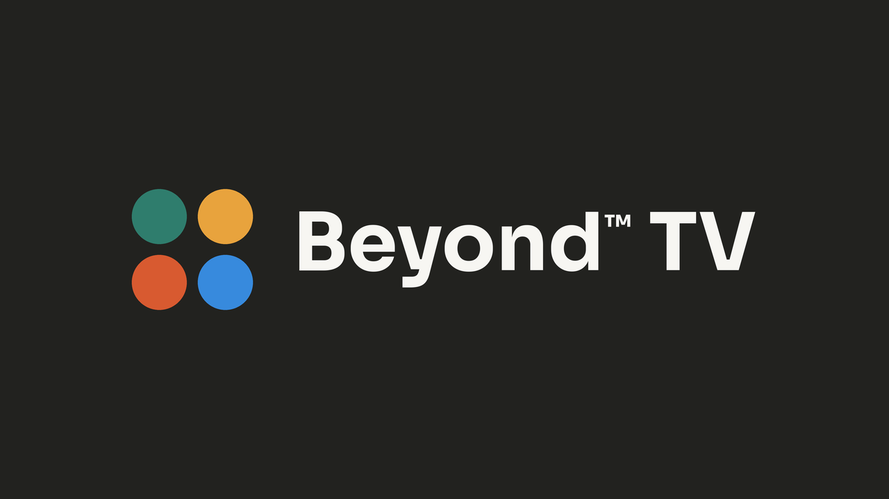
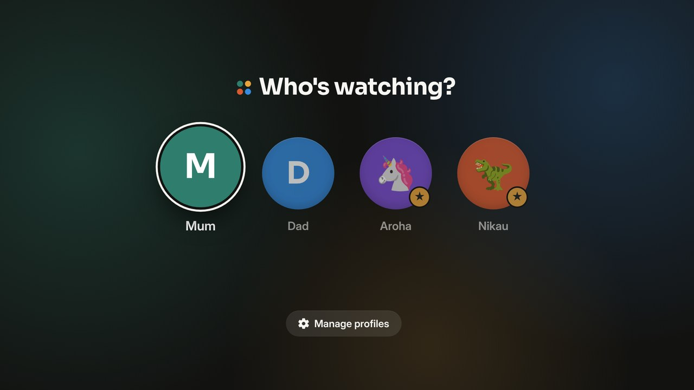
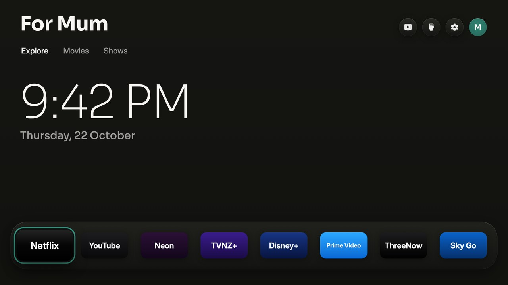
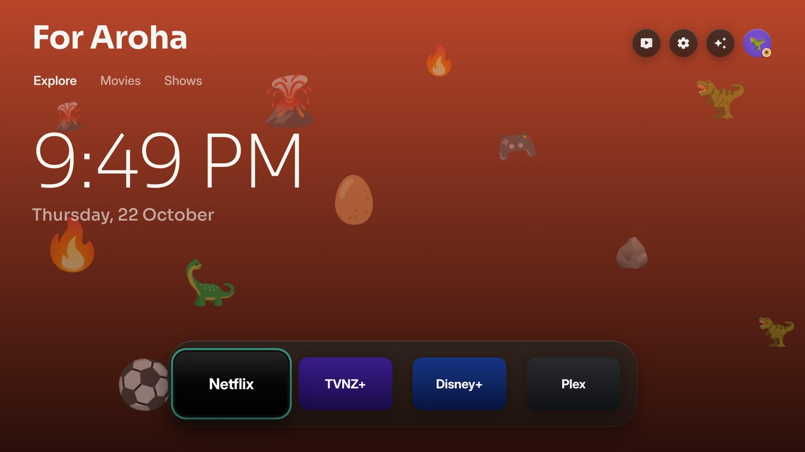
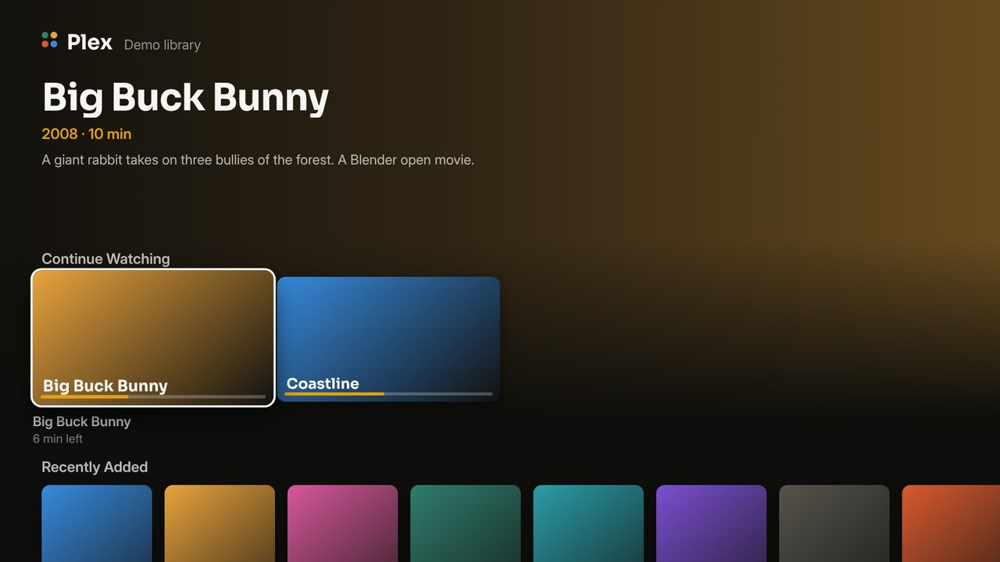
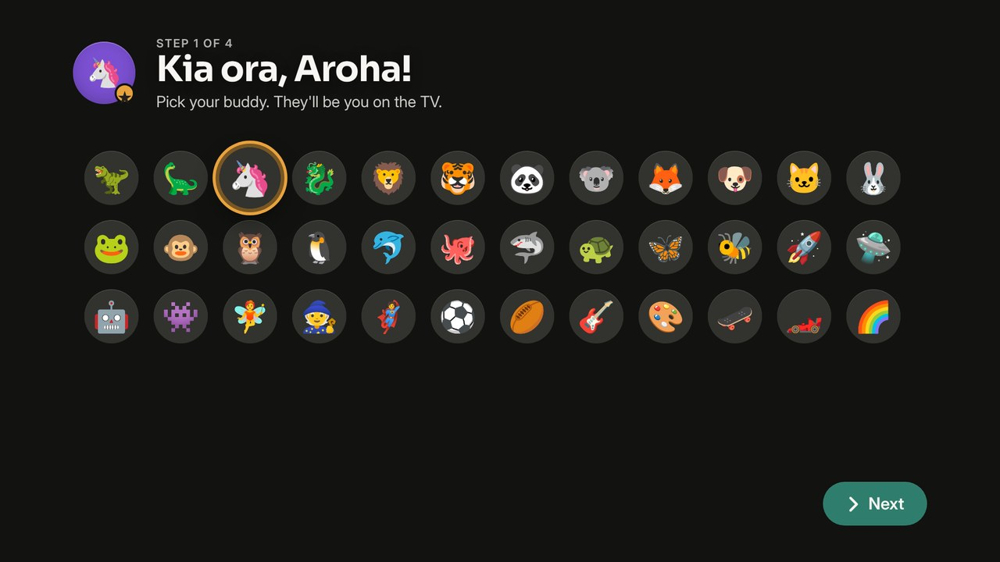
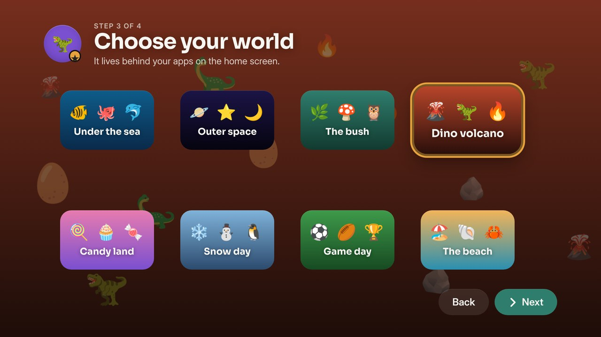
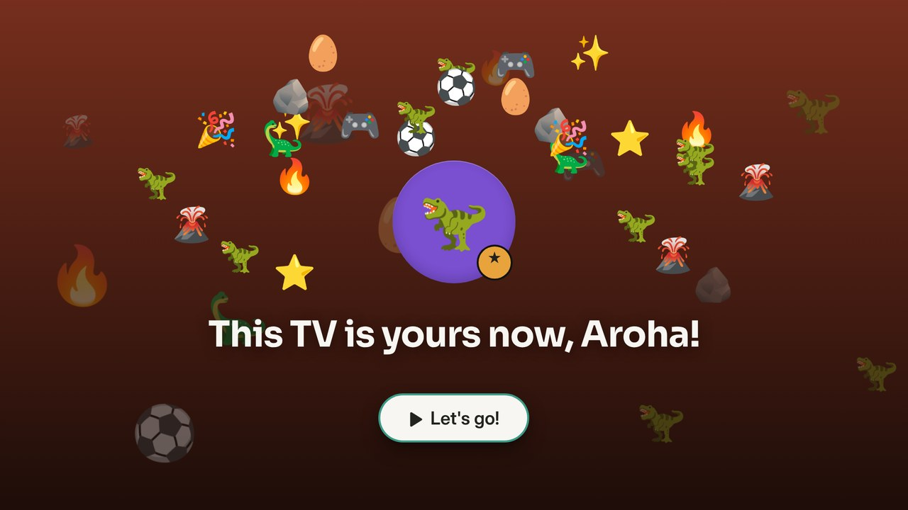
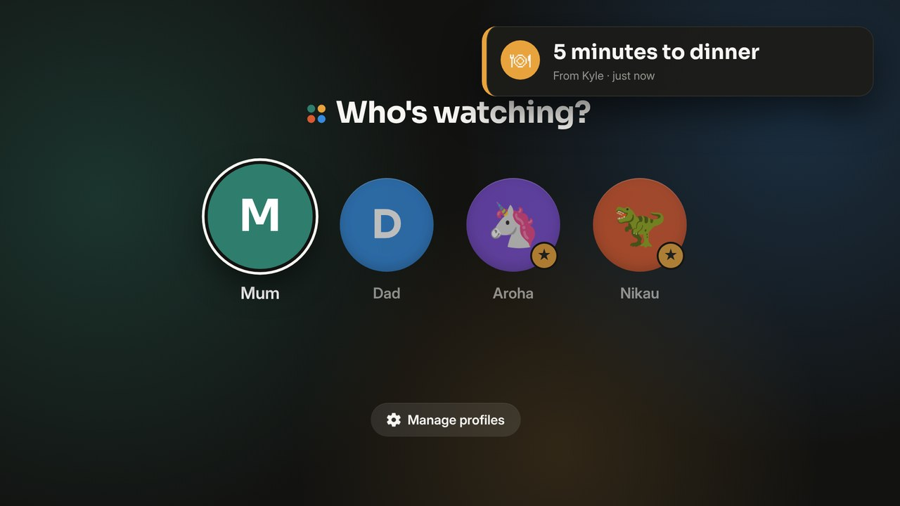

<div align="center">


# Beyond™ TV

## Free your world.

**One calm home screen for the whole whānau, on Google TV, LG and Samsung TVs.**

Your streaming apps in one App Dock, what's worth watching tonight, and no ads.<br>
Free and open source, built in Aotearoa by [Beyond](https://gobeyond.co.nz). One button to undo.

[Install](#install) · [LG TVs](#lg-tvs-webos) · [Samsung TVs](#samsung-tvs-tizen) · [Any TV](#any-tv) · [Change the code](#change-the-code) · [Roadmap](#roadmap)



</div>

## Screenshots

<table>
<tr><td></td>
<td></td></tr>
<tr><td></td>
<td></td></tr>
<tr><td></td>
<td></td></tr>
<tr><td></td>
<td></td></tr>
</table>

## What you get

- **Pinned tiles.** Pick up to six tiles in Beyond Family: an app, a show, the kids' jobs ticking off, a camera at home. Every TV opens on them.
- **Make it yours.** Kids make it theirs on their own profile, with the remote, no grown-up needed: a buddy, a colour, a world that fills their home screen, and the things they love drifting through it. On Google TV, LG and Samsung (on Google TV from Who's watching).
- **No ads.** No sponsored rows, banners or autoplaying promos.
- **Your apps, front and centre.** Netflix, Neon, TVNZ+, Disney+, ThreeNow, Plex and the rest in one App Dock, in the order you pick on the TV.
- **Trending, not sponsored.** Fresh picks every hour from what's trending and the latest releases, only from apps you already have.
- **Weather one press away.** Hour by hour, with sunrise and sunset.
- **Light by day, dark by night.** It follows your city's real sunset.
- **Beyond's look.** Paper and ink, Sora headings, and focus in Beyond's moss green, the same family as [Beyond Family](https://beyondfamily.app).
- **Safe.** No root. Nothing is uninstalled. One button brings back the factory home screen.

## Roadmap

1. Who's watching: done. Family first (everyone together, family-friendly picks), then a profile for each person, with kids' profiles behind a grown-up PIN, and no settings at all for kids. Asked every time the TV comes on.
2. Plex built in: link with a code at plex.tv/link, then Continue Watching and Recently Added on the home screen.
3. All your services as one: one "What's on" across every service you have, opening each title in its own app.
4. Beyond Family: pairing the TV with your household (a code typed into the app), the household's people as profiles, a phone remote and messages on the screen (full screen, even over YouTube on Google TV, until somebody presses OK): done on Google TV, LG and Samsung. On Google TV in Beyond TV mode the remote works inside other apps too. Still to come: voice search for kids and the family house game on the big screen.
5. Picks for kids: done on Google TV, LG and Samsung. A kid's cards are good shows matched to what they're into, set by a grown-up (Beyond Family or behind the PIN) or by the kid ("What do you like to watch?"), and coming back from an app the TV now and then suggests one. No TMDB key needed. On Google TV the picks come from what is set in Beyond Family; the "What do you like to watch?" card and the suggestion after an app are LG and Samsung for now.
6. Two homes, one show: done on LG and Samsung. The Beyond Family app starts a countdown on every TV in two linked homes, and reactions come from phones. Google TV once it pairs with Beyond Family.
7. Earn your screen: done on Google TV, LG and Samsung. Switched on in Beyond Family, a kid's apps wait until their jobs for today are ticked off. On Google TV the remote's own app buttons (Netflix, YouTube) still open their apps for now.
8. The house noticeboard: done on LG, Samsung and Google TV. Switched on in Beyond Family, today's calendar, tea, birthdays and notes show in Tonight at home, and on LG and Samsung beside the screensaver clock too.
9. Bedtime breathing: done on Google TV, LG and Samsung. A night light that breathes, slowing from six breaths a minute, then fades to dark. From the moon on the home screen in the evening, or from the Beyond Family app.
10. Fine day nudge: done on LG and Samsung. On a mild, dry day the TV suggests going outside, and counts the time as green time in Beyond Family when you're back.
11. Dinner question: done on Google TV, LG and Samsung. One question on the TV from Beyond Family, answered from phones, and the answers revealed together.
12. Te reo word of the day: done on Google TV, LG and Samsung. A new kupu each day on the home screen, with what it means, and on the LG and Samsung screensaver how to say it. Te reo is a choice under *Language* in Beyond™ TV Settings: *English and te reo Māori*, or plain *English*, where the word of the day goes and "Kia ora" becomes "Hello".
13. Beyond™ TV for business (testing now): shop-window screens changed from the web, as a subscription. Open tv.beyondspaces.nz on the TV, type its code into Beyond™ Spaces, and it plays your pictures, videos and web pages. Free for homes, always.
14. Your face on any TV: done on Google TV, LG and Samsung. Each person's face, colour, world, loves and shelf live with them in Beyond Family, so every TV at home shows them and a new TV brings them across. On somebody else's Beyond TV, Who's watching › Sign in with Beyond Family shows a code to type into your phone, and your own profile is there until you sign out. Google TV takes the face, colour, world and loves; the shelf follows.
15. Sleep timer: done on Google TV, LG and Samsung. Sleep Timer in the menu under the App Dock: each press picks 15, 30, 60 or 90 minutes, or off. A note a minute before, then the TV turns off (on Samsung, which lets no app turn it off, the screen goes dark until a key is pressed).
16. Art mode: done on Google TV, LG and Samsung. Like a Samsung Frame, the screensaver shows paintings from the Art Institute of Chicago's public domain collection, filling the screen with no clock or words on it (family messages still show; only paintings about the screen's shape are picked, so little is cropped), a new set each day. Beyond™ TV Settings › Kind of art picks landscapes, the sea, gardens and flowers, mountains, impressionism, still life or Mixed (a different theme each day). On Mixed, in a season it shows our own art instead: Halloween (24/10 to 1/11) and a New Zealand summer Christmas (1/12 to 26/12), drawn by `tools/season_art.js` and listed in `docs/art/seasons.json`, so new pictures reach every TV without an update. On by itself when there is no TMDB key; Beyond™ TV Settings › Screensaver picks Art or Film photos.
17. Have the pets been fed?: done on LG and Samsung. When a kid picks their face and the household's pets in Beyond Family still want a meal, the TV asks. "Yes" ticks them fed in Beyond Family with the kid's name; "Not yet" sends them off and the TV asks again later. Google TV soon.
18. A home screen of its own: done on LG, Samsung and Google TV. A "Kia ora" greeting with your name, Keep watching (what you last opened from Beyond, per profile, as little TV screens; Netflix doesn't share its own list, so it's what Beyond opened), and Tonight at home beside it: tea, birthdays, today's calendar, notes and the weather, with a Beyond Family badge and faces when linked.
19. Your home: done on Google TV, LG and Samsung (Google TV shows the first three rooms). With a Beyond Home box (the Beyond Home app on a Home Assistant box) on the same network, the home screen gets a *Your home* tab: a card for each room, Moments like Movie night in one press, one remote for the room's sound and every light, heat pump, blind and plug on or off. Pair once with a code typed in the Beyond Home app (Settings, TVs). The TV only asks for named things; the box decides what that means and refuses anything off its list. On the way: energy (what the house is using now, how much the solar covers, the cheapest time to run the dishwasher), cameras with a password and live video, and your house as you drew it in Beyond Family.
20. Pinned tiles: done on Google TV, LG and Samsung. Pick up to six tiles in Beyond Family and every TV at home opens on them: an app, a show you're all watching, the kids' jobs for today ticking off, or a camera on your home network (its picture every few seconds, full screen on OK). The camera's picture comes straight to the TV, never through Beyond Family. Google TV shows the first three; cameras with a password, and live video, come with Beyond Home.
21. Tidy-up race: done on Google TV, LG and Samsung. Set a time in Beyond Family (TV › Tidy-up race), and every night the TV starts a countdown with everyone's face; whoever's done presses OK on theirs, first, second, third, then "All tidy!". Google TV turns itself on for it (through its own ADB, with the key it already allowed); LG and Samsung start it when the TV is on. From the remote in Beyond Family any time.
22. The start chime: done on Google TV, LG and Samsung. Four soft notes, one for each of Beyond's dots, when the TV comes on and when the tidy-up race starts and ends. Beyond™ TV Settings › Sounds turns it off. The notes are in ADR 0012; `tools/make_chime.py` writes them as a WAV.
23. Quiz night: done on Google TV, LG and Samsung. Ten family-friendly questions on the TV, four answers each; everyone buzzes in from their phone in Beyond Family, the first tap counts, right is two points and first right in gets one more. The answer and the scores come up when a grown-up says so, then the final scores. Still to come for the family evening: arcade games played with the remote.
24. Party mode: done on Google TV, LG and Samsung. A disco or a birthday, from the Party button on the TV (no phone needed) or from Beyond Family: music the TV makes itself, coloured lights sweeping the screen on the beat, and for a birthday the tune, a cake and their name. With Beyond Home, the room's lights go bright and colourful, change with the music, and go back to warm white after.
25. Teen profiles: done on Google TV, LG and Samsung. A kid of 13 or more gets YouTube and music on their shelf as well as the kids' apps, still behind the grown-up PIN. Beyond Family works it out from their birthday, so it happens by itself on the day; the TV only hears yes or no.
26. Karaoke night: done on Google TV, LG and Samsung. Keep the songs your family loves in Beyond Family, queue up from your phones, and Next singer puts whoever's up on the TV, then plays the song's karaoke version from YouTube, words and all.
27. Games on the TV: done on Google TV, LG and Samsung. A Games button on the home screen holds karaoke, a party, quiz night, the dinner question, the tidy-up race and bedtime breathing, all started from the remote. Pick who's singing and a song right on the TV, and run the quiz from the couch: show the answer, next question, finish. Who's watching fits a big family on one screen.

Ideas welcome: press the four dots (*Talk to Beyond*) on the TV.

## Install

About five minutes, for a Google TV or Android TV (Android 8 or newer, so Sony's 2015 Bravias too). Nothing is rooted or uninstalled.

**First, on the TV:** Settings → System → About, press *Build* (or *Android TV OS build*) seven times, then Settings → System → Developer options → turn on **USB debugging**. Beyond™ TV needs it to switch the home screen, and the computer installers use it too.

### On the TV, no computer

1. Install **Downloader** (by AFTVnews) from the Play Store on the TV.
2. Open it, type **`yeahbuddynz.github.io/Beyond.TV/tv`** and press *Go*.
3. Press **Download Beyond™ TV**, then *Install* and *Open*. If the TV asks, allow Downloader to install apps.

### From a computer, one line

On the same Wi-Fi as the TV. It downloads Google's adb if you don't have it (into a folder of its own), finds your TV, installs Beyond™ TV, opens it and tells you what to press.

- **Mac or Linux**, in Terminal:
  ```bash
  curl -fsSL https://raw.githubusercontent.com/YeahBuddyNZ/Beyond.TV/main/install.sh | bash
  ```
- **Windows**, in PowerShell:
  ```powershell
  irm https://raw.githubusercontent.com/YeahBuddyNZ/Beyond.TV/main/install.ps1 | iex
  ```

The TV asks *Allow USB debugging?*: tick *Always allow* and press OK.

### Then, on the TV

Open *Beyond™ TV* → *Home Screen* → *Beyond™ TV*, and allow debugging once more. Your city, the App Dock and the profiles are in its settings. From then on it keeps itself up to date: when there's a new version the TV asks, and one OK installs it.

These installs are the ready-made build: Auckland until you pick your city on the TV, and no trending picks (those need your own [TMDB key](#the-tmdb-key), so build it yourself below).

### With an AI assistant

Open [Claude Code](https://claude.com/claude-code), Codex or Antigravity and say:
> Install Beyond™ TV (github.com/YeahBuddyNZ/Beyond.TV) on my TV at 192.168.1.50. I live in Auckland.

It builds your own copy with your city and your TMDB key, puts it on your TV, and asks before anything important.

### Build it yourself

1. **On the TV**, turn on USB debugging (above).
2. **Tools:** a JDK (17+), the Android SDK command-line tools (build-tools 34, platform android-34) and adb. On a Mac:
   ```bash
   brew install --cask temurin android-commandlinetools android-platform-tools
   sdkmanager "build-tools;34.0.0" "platforms;android-34"
   ```
   On Linux, get OpenJDK 17, Android's command-line tools and adb from your package manager, then run the same `sdkmanager` line. On Windows, use Git Bash (which Claude Code uses there) or WSL.
3. **Build:**
   ```bash
   ./build.sh
   ```
   The first run creates `config.properties`. Set your city and your [TMDB key](#the-tmdb-key) there, then run it again.
4. **Install:**
   ```bash
   adb connect 192.168.1.50:5555
   adb install -r BeyondTV.apk
   ```
   On TCL TVs, also let it run in the background (TCL blocks it by default, and the switch never starts):
   ```bash
   adb shell "appops set nz.gobeyond.tv AUTO_START allow || appops set nz.gobeyond.tv APP_AUTO_START allow"
   ```
5. **On the TV**, open *Beyond™ TV* → *Home Screen* → *Beyond™ TV*.

## LG TVs (webOS)

The same home screen as an LG app: the picks, the glass App Dock with your apps, the drawer with inputs, weather and prices, day and night, Beyond™ TV Settings and the App Dock editor. It installs through LG's own Developer Mode, with nothing rooted or changed on the TV. LG's home screen stays where it is, and Beyond™ TV is one press of a number key away.

You need an LG TV (webOS 3 or newer) and a computer on the same Wi-Fi, with Python 3.

1. **On the TV**, open the LG Content Store and install **Developer Mode**. Sign in with a free [LG developer account](https://webostv.developer.lge.com), turn on **Dev Mode Status** (the TV restarts), then turn on **Key Server**. Write down the IP address and the passphrase it shows.
2. **On your computer**, get the code and build. `config.properties` works as for Google TV (your city, your [TMDB key](#the-tmdb-key)):
   ```bash
   git clone https://github.com/YeahBuddyNZ/Beyond.TV && cd Beyond.TV
   python3 webos/build.py
   ```
3. **Install.** The first time, it asks for the TV's passphrase; updates don't:
   ```bash
   python3 webos/install.py 192.168.1.50
   ```
4. **On the TV**, while Beyond™ TV is open, hold a number key on the remote. From then on, that key opens it from anywhere.

With an AI assistant, say *"Install Beyond™ TV (github.com/YeahBuddyNZ/Beyond.TV) on my LG TV at 192.168.1.50. I live in Auckland."* It builds the app and hands you the install command, so you type the passphrase yourself.

Developer Mode lasts about 40 days: open the Developer Mode app now and then and press **EXTEND**. To remove Beyond™ TV, run `python3 webos/install.py 192.168.1.50 --uninstall`.

## Samsung TVs (Tizen)

The same home screen as a Samsung app, with everything the LG one has: the picks, the App Dock, the drawer with the inputs, the weather and the prices, day and night, and its own settings. It installs through Samsung's own Developer Mode, with nothing rooted or changed on the TV, and Samsung's home screen stays where it is.

You need a Samsung TV from 2017 or newer (Tizen 3+) and a computer on the same Wi-Fi.

1. **On the TV**, open **Apps** and type `1 2 3 4 5` on the remote. Turn **Developer mode** on, type your computer's IP address in **Host PC IP**, and restart the TV.
2. **On your computer**, download [TizenBrew Installer](https://github.com/reisxd/TizenBrewInstaller/releases/latest), the community's installer for Samsung TVs, open it and connect to your TV.
3. **Install from GitHub:** type `YeahBuddyNZ/Beyond.TV`. On 2023 and newer TVs it asks you to sign in to your Samsung account once, to sign the app for your TV.
4. **Straight to it:** in the TV's settings, under Start Screen Options, turn on **Autorun Last App**: the TV turns on into Beyond™ TV.
24. Screensaver after a few minutes: done on Google TV, LG and Samsung. When nobody has pressed anything on the home screen for 3 minutes, the screensaver comes on. *Screensaver after* in Beyond™ TV Settings picks 1, 3, 5, 10, 15 or 30 minutes. The TV's own screensaver and standby times stay as they were.

This build takes your city from the TV's time zone. For your exact city and the trending picks, build it with your own `config.properties` and [TMDB key](#the-tmdb-key): open the folder in Claude Code and say *"Install Beyond™ TV on my Samsung TV at 192.168.1.50. I live in Auckland."* It sets up Samsung's tools, and on 2023 and newer TVs you sign in to your Samsung account in the browser to make the certificate. Your signed build installs with `python3 tizen/install.py 192.168.1.50`, which needs only Python: no Tizen Studio, and no Rosetta on Apple Silicon Macs.

## Settings

The first values come from `config.properties`, created by the first build (Google TV, LG and Samsung use the same file). Most of them can also be changed on the TV, in *Beyond™ TV* → *Beyond™ TV Settings*, and the TV's choice wins:

| Key | What it does | Default |
|---|---|---|
| `tmdb_key` | Your free TMDB key, for the picks | empty |
| `tmdb_region` | Your country (two letters): which titles are on which app | `NZ` |
| `watchmode_key` | Optional, free [Watchmode](https://api.watchmode.com/) key: a pick opens the title's page in its app | empty |
| `latitude`, `longitude` | Your city, for the weather and the sunset | Auckland |
| `city` | The name on the weather card | `Auckland` |
| `hide_animation` | Leave cartoons and anime out of the picks | `false` |
| `language` | `auto` (follows the TV), `en`, `es`, `pt`, `ru` or `de` | `auto` |
| `show_crypto` | Show Binance crypto prices on home and screensaver | `false` |
| `currency` | Crypto prices in `NZD`, `USD`, `EUR`… | `NZD` |
| `temperature` | `C`, `F` or `auto` | `C` |
| `disable_assistant` | Also turn off Google Assistant | `false` |

Changed something? Run `./build.sh` and install again. Keep `beyondtv.keystore`: updates are signed with it.

### The TMDB key

Free, and it takes two minutes: create an account at [themoviedb.org](https://www.themoviedb.org/signup), then open [Settings → API](https://www.themoviedb.org/settings/api) and request a developer key. Paste the *API Read Access Token* (or the *API Key*) after `tmdb_key=`. It's your key: `config.properties` stays out of git.

### Opening a title, not just its app (optional)

With a free [Watchmode](https://api.watchmode.com/) key (`watchmode_key=` in `config.properties`), a pick opens its own page in the streaming app instead of the app's home. The free plan (2,500 credits a month) is enough: each title costs two requests the first time and is remembered after that. It works where the app takes the title's web address (tested: Prime Video and JioHotstar); where it doesn't, the pick just opens the app, as without a key.

## Going back

On the TV: *Beyond™ TV* → *Home Screen* → *Original*. The factory home screen, screensaver and every app come back exactly as they were. If the new home screen ever crashes three times in five minutes, it switches back by itself.

To remove it for good, switch to *Original* first, then uninstall *Beyond™ TV* (Settings → Apps). Uninstalled it while it was on? Install it again and pick *Original*: the list of what it turned off is kept in the TV's settings, so everything comes back.

## What it changes

- It becomes the home screen and the screensaver.
- It turns off, without uninstalling:
  - the stock home screen and screensaver;
  - Google TV's recovery home, Play Games and YouTube Music;
  - on TCL TVs, the TCL Channel, messages, store demo, hotel menu, manuals, mirroring and logging apps;
  - on Philco TVs, AI PONT (promo channels and app downloads) and the manual;
  - on Multilaser TVs, Anoki's screen-content recognition (ACR), the store demo and the manual;
  - on KTC-made TVs (NextStar), Anoki's screen-content recognition (ACR), the store demo and the manual;
  - Google Assistant, only with `disable_assistant=true`.
- On TCL TVs, the remote's Netflix, YouTube and Prime buttons keep working through a small accessibility service that only reads those buttons. Pick what each one opens in *Beyond™ TV* → *Remote Buttons*; *Original* turns the service off. On Vestel-made TVs (F&U and other store brands) and Xiaomi (Formovie) projectors the same goes for the Netflix button, and on KTC-made TVs (NextStar) for the Tabii button. On Sony TVs, the BRAVIA CORE, Netflix, Disney+, Prime Video, YouTube and Crunchyroll buttons can each open the app you pick, or keep Sony's default.
- Picture, sound, inputs, remote pairing, Google services and the Play Store are on a protected list, checked before every change.
- Apps that saved a Wi-Fi network are never turned off, since Android would erase the network. If the TV's first setup saved yours, the switch asks you to forget the network and connect again in Settings first (saved networks out of range don't show there; Claude Code can remove them).

## Any TV

Beyond™ TV runs on Google TV and Android TV: TCL, Sony, Hisense, Philips, Xiaomi, Vestel-made TVs (F&U), KTC-made TVs (NextStar) and more, plus streamers like Chromecast with Google TV, the Google TV Streamer, onn 4K and NVIDIA Shield. And on [LG](#lg-tvs-webos) and [Samsung](#samsung-tvs-tizen) TVs, as an app.

**Any other TV:** plug a Google TV streamer into HDMI and free that one. Same steps, same home screen.

**A different brand or model:** ask Claude. Beyond™ TV is made to be adapted by AI. Open the folder in Claude Code and say *"set it up for my Sony"*: it reads your TV, finds its home screen and its promo apps, updates the lists below and walks you through a test. [CLAUDE.md](CLAUDE.md) tells it how.

| What | Where |
|---|---|
| Apps to turn off | `DEBLOAT` in [`HomeMode.java`](app/src/nz/gobeyond/tv/HomeMode.java) |
| Apps never to touch | `PROTECTED` in the same file |
| Apps on the shelf | `SHELF` in [`HomeApps.java`](app/src/nz/gobeyond/tv/HomeApps.java) |
| Your brand's live TV app | `LIVE_TV_APPS` in the same file |

## Change the code

It's your code, and Claude Code finds its way around it. Try:

- *"Add Crunchyroll to the shelf."*
- *"Show the prices in euros."*
- *"Add Spanish."*
- *"Switch to the night look an hour after sunset."*

## How it works

- **A plain Android app, no Gradle, no libraries.** [`build.sh`](build.sh) runs aapt2 → javac → d8 → zipalign → apksigner and makes a 2 MB APK.
- **It uses the TV's own ADB, from inside the TV.** The app connects to `127.0.0.1:5555` with its own key (that's the *Allow USB debugging?* prompt) and runs the same commands you would: `cmd package set-home-activity`, `settings put secure screensaver_components`, `pm disable-user`. Nothing listens to the network.
- **Drawn by hand on one Canvas**, with Android 13 shaders for the frosted glass and the sky (plain fills on Android 8 to 12, with lighter shadows and no GPU layers on 8 to 11 for their older GPUs).
- **A safety net.** A watchdog in a separate process brings back the stock home screen after three crashes in five minutes, and a boot check keeps your choice after TV updates.
- **On LG and Samsung, the same design in plain HTML, CSS and JavaScript** ([`web/`](web)), written for the Chromium of older TVs, with no frameworks. [`webos/build.py`](webos/build.py) packs it with `config.properties` into an `.ipk` without LG's tools, and [`webos/install.py`](webos/install.py) installs it through Developer Mode; on LG it lists and opens apps through the TV's own service bus (Luna), as LG's launcher does. [`tizen/build.py`](tizen/build.py) packs the same app into a Samsung `.wgt`, which uses Tizen's web APIs for the apps and the inputs. To preview it on a computer: `python3 webos/build.py --preview`, then open `out/webos/index.html` (a stand-in lists sample apps).
- **Data** from TMDB (trending titles, new releases and which app streams what in your country), Open-Meteo (forecast, sunrise and sunset), and optionally Binance (24-hour prices when `show_crypto=true`).

| File | What it is |
|---|---|
| [`HomeView.java`](app/src/nz/gobeyond/tv/HomeView.java) | The home screen |
| [`HomeMode.java`](app/src/nz/gobeyond/tv/HomeMode.java) | Switching between Beyond™ TV and Original |
| [`Adb.java`](app/src/nz/gobeyond/tv/Adb.java) | The TV's own ADB, from inside the TV |
| [`Recs.java`](app/src/nz/gobeyond/tv/Recs.java) | The picks (TMDB) |
| [`HomeData.java`](app/src/nz/gobeyond/tv/HomeData.java) | Weather and prices |
| [`HomeApps.java`](app/src/nz/gobeyond/tv/HomeApps.java) | The shelf, inputs and All Apps |
| [`DreamView.java`](app/src/nz/gobeyond/tv/DreamView.java) | The screensaver |
| [`SettingsActivity.java`](app/src/nz/gobeyond/tv/SettingsActivity.java) | The settings screen (the app's icon) |
| [`Prefs.java`](app/src/nz/gobeyond/tv/Prefs.java) | Settings changed on the TV |
| [`RemoteKeys.java`](app/src/nz/gobeyond/tv/RemoteKeys.java) | The TCL remote's app buttons |
| [`Watchdog.java`](app/src/nz/gobeyond/tv/Watchdog.java) | The safety net |
| [`web/home.js`](web/home.js) | The home screen on LG TVs |
| [`web/tv.js`](web/tv.js) | The TV's apps and inputs, on LG and Samsung |
| [`webos/build.py`](webos/build.py), [`webos/install.py`](webos/install.py) | The LG app package and its install |
| [`tizen/build.py`](tizen/build.py) | The Samsung app package |

The website is in [`docs/`](docs): plain HTML and CSS on GitHub Pages.

## Privacy

No accounts, no ads, no tracking. The app talks to TMDB, Open-Meteo (with the coordinates you set, or your time zone's main city), Binance only when `show_crypto=true`, Watchmode only when you set a `watchmode_key`, the Art Institute of Chicago (for the paintings) and this project's own website (for the seasonal art) when the screensaver is in Art mode, and Beyond Family only when you link the TV to it. Your settings stay on your computer and your TV.

**The daily check-in.** So we can fix a problem on one make of TV before anybody has to ask, once a day the TV tells Beyond (beyondfamily.app) a made-up id, its city rounded to about 10km, its make, model and Android or TV software version, the Beyond TV version, which home screen is on, how many times the home screen opened and crashed, and its last 20 error messages. Never what anybody watches, never an IP address kept, never a name or a household.

**Linked to Beyond Family**, the TV learns the household's name and each person's first name, colour and whether they're a kid, plus the household's pets (name, kind and whether they've been fed today), what the household switched on (today's jobs, the noticeboard) and what a grown-up said each kid is into, for their picks. Each person's face, colour, world, what they love and their shelf (apps by name) are kept with them in Beyond Family, so they follow them to every TV they're on. Somebody signed in on a TV from another home brings only their own first name, colour and look; that TV learns nothing about their household, and they can sign out from the TV or their phone. What a kid is into stays on the TV otherwise. **Beyond™ TV Settings → Help fix problems** turns it off, and turning it off asks Beyond to delete everything it had for that TV. The code is [`Checkin.java`](app/src/nz/gobeyond/tv/Checkin.java) and [`web/checkin.js`](web/checkin.js).

## Credits

- Built with [Claude Code](https://claude.com/claude-code), on top of [Free My TV](https://github.com/simbasjungles/free-my-tv) (MIT) and its contributors.
- The LG version builds on what [@danielthejoker18](https://github.com/danielthejoker18) found in [FreeMyTvWebOS](https://github.com/danielthejoker18/FreeMyTvWebOS) (MIT): installing through Developer Mode and opening apps through the TV's service bus.
- On Samsung TVs it installs with [TizenBrew Installer](https://github.com/reisxd/TizenBrewInstaller) by [@reisxd](https://github.com/reisxd).
- This product uses the TMDB API but is not endorsed or certified by [TMDB](https://www.themoviedb.org/).
- Links to the titles in the streaming apps by [Watchmode](https://api.watchmode.com/).
- Weather data by [Open-Meteo.com](https://open-meteo.com/) (CC BY 4.0). Prices from the [Binance](https://www.binance.com/) public API.
- Icons: [Material Symbols](https://fonts.google.com/icons) (Apache 2.0). Fonts: [Inter](https://rsms.me/inter/) and [Sora](https://github.com/sora-xor/sora-font) (SIL OFL 1.1). Coin logos: [cryptocurrency-icons](https://github.com/spothq/cryptocurrency-icons) (CC0). Samsung app logos: [Simple Icons](https://simpleicons.org) (CC0).
- Not affiliated with Google, TCL, LG, Samsung or any streaming service. App names and logos belong to their owners.

## Licence

Beyond™ TV is GPL-3.0 ([LICENSE](LICENSE)). It began as a fork of [Free My TV](https://github.com/simbasjungles/free-my-tv)
and keeps its history; that code's MIT licence is kept in [LICENSE-free-my-tv.txt](LICENSE-free-my-tv.txt).

## Trade marks

The code is GPL-3.0, so you are free to use, change and share it under that licence. The name is not part of the
licence. Beyond™, Beyond™ TV, Beyond™ Spaces, Beyond™ Family and Beyond's four coloured dots are trade marks of Global
Support Limited (BEYOND is registered in New Zealand, IPONZ 1251473). If you share a changed version, give it your own
name and icon, and don't say it comes from Beyond.

Beyond™ TV for business, the paid shop-window screens, is a separate product and is not in this repository.
